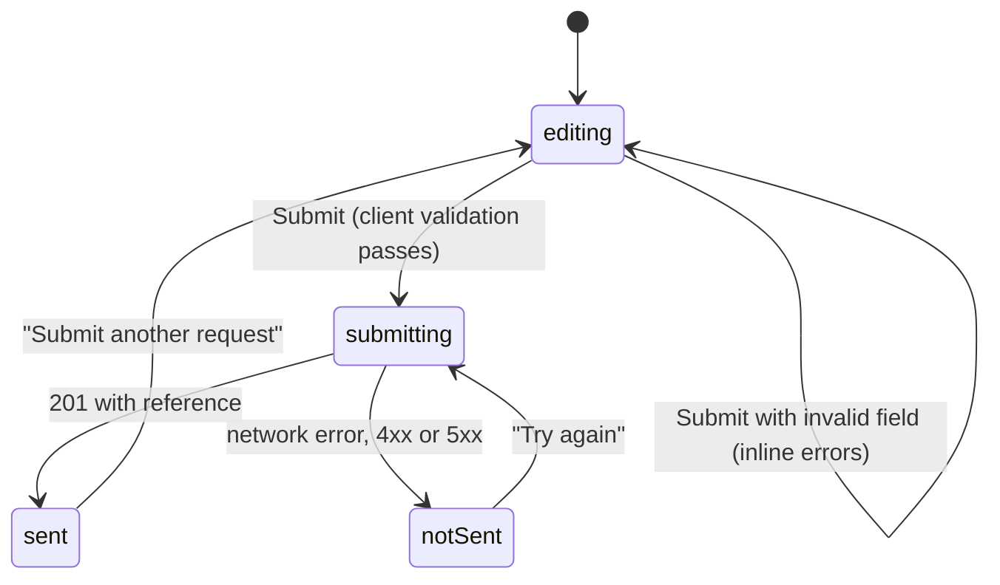
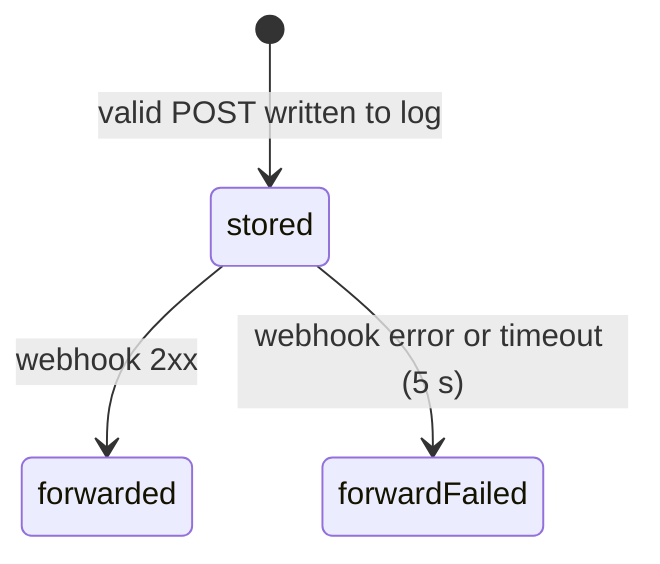
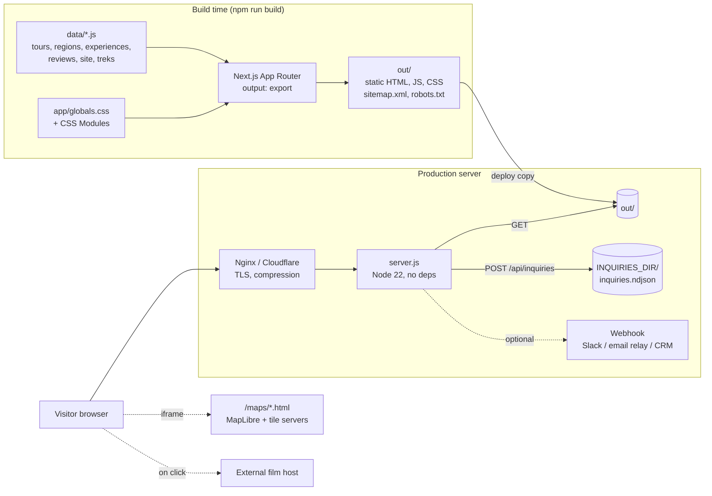
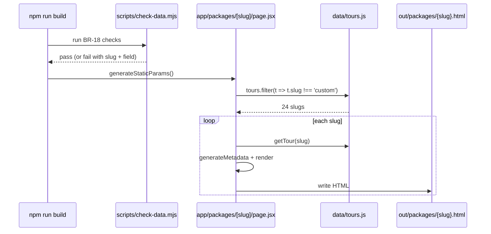
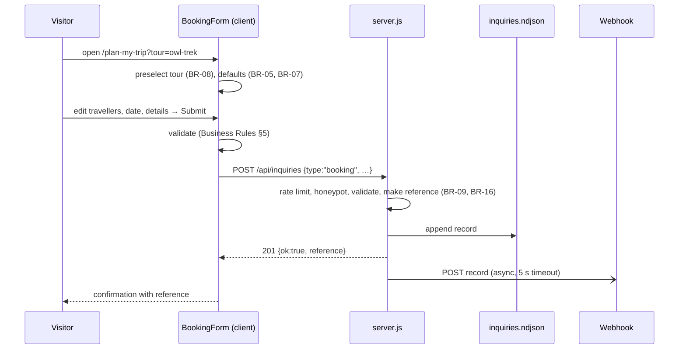
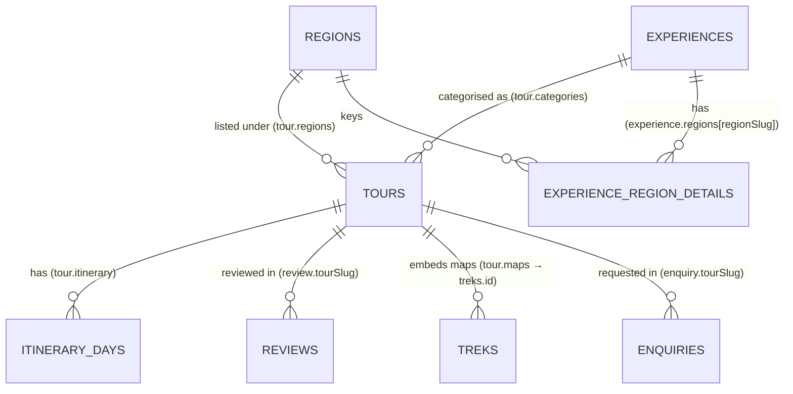
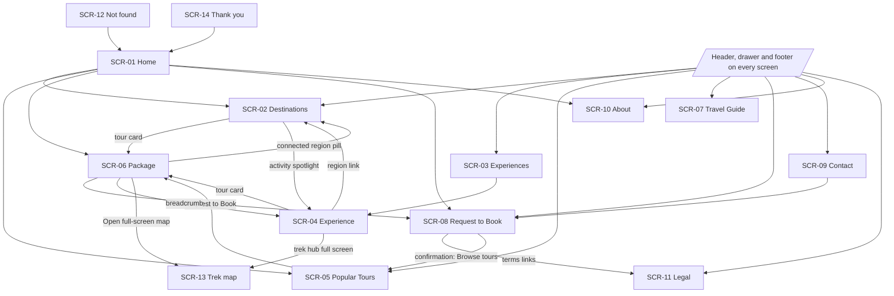

# Yuevaan Bhutan Travels React Rebuild — Project Spec

## Contents

1. [Yuevaan Bhutan Travels React Rebuild — Project Docs](#yuevaan-bhutan-travels-react-rebuild--project-docs)
2. [PRD — Yuevaan Bhutan Travels React Rebuild](#prd--yuevaan-bhutan-travels-react-rebuild)
3. [Business Rules — Yuevaan Bhutan Travels React Rebuild](#business-rules--yuevaan-bhutan-travels-react-rebuild)
4. [TRD — Yuevaan Bhutan Travels React Rebuild](#trd--yuevaan-bhutan-travels-react-rebuild)
5. [Architecture — Yuevaan Bhutan Travels React Rebuild](#architecture--yuevaan-bhutan-travels-react-rebuild)
6. [Security & Access — Yuevaan Bhutan Travels React Rebuild](#security--access--yuevaan-bhutan-travels-react-rebuild)
7. [Backend Schema — Yuevaan Bhutan Travels React Rebuild](#backend-schema--yuevaan-bhutan-travels-react-rebuild)
8. [API Spec — Yuevaan Bhutan Travels React Rebuild](#api-spec--yuevaan-bhutan-travels-react-rebuild)
9. [App Flow — Yuevaan Bhutan Travels React Rebuild](#app-flow--yuevaan-bhutan-travels-react-rebuild)
10. [Design — Yuevaan Bhutan Travels React Rebuild](#design--yuevaan-bhutan-travels-react-rebuild)
11. [Phases — Yuevaan Bhutan Travels React Rebuild](#phases--yuevaan-bhutan-travels-react-rebuild)
12. [Acceptance Criteria — Yuevaan Bhutan Travels React Rebuild](#acceptance-criteria--yuevaan-bhutan-travels-react-rebuild)
13. [Rules — Yuevaan Bhutan Travels React Rebuild](#rules--yuevaan-bhutan-travels-react-rebuild)
14. [Memory — Yuevaan Bhutan Travels React Rebuild](#memory--yuevaan-bhutan-travels-react-rebuild)

---

## Yuevaan Bhutan Travels React Rebuild — Project Docs

**A fast, search-friendly marketing and enquiry website for a licensed Thimphu tour operator, rebuilt in React (Next.js) from 42 hand-copied HTML pages into shared components driven by one set of data files.**

- **Stack:** Next.js 16.4 (App Router, static export) + React 19, JavaScript (`.jsx`), existing CSS ported as global CSS, content in `data/*.js`, dependency-free Node `server.js` for static serving, enquiries and redirects ([03-TRD.md](#trd--yuevaan-bhutan-travels-react-rebuild)).
- **Source site:** the `Travel_Agency` folder (static HTML/CSS/JS). Place it next to the new project as `../Travel_Agency/` so the agent can compare pages and run the one-off extraction script.
- **Status:** Planning complete — current phase in [13-MEMORY.md](#memory--yuevaan-bhutan-travels-react-rebuild).

### Reading order for AI agents

1. [12-RULES.md](#rules--yuevaan-bhutan-travels-react-rebuild) — how to work (every session)
2. [13-MEMORY.md](#memory--yuevaan-bhutan-travels-react-rebuild) — where the project stands (every session)
3. [01-PRD.md](#prd--yuevaan-bhutan-travels-react-rebuild) and [02-BUSINESS-RULES.md](#business-rules--yuevaan-bhutan-travels-react-rebuild) — what to build and its exact logic
4. The docs for the current task:
   - Data work → [06-BACKEND-SCHEMA.md](#backend-schema--yuevaan-bhutan-travels-react-rebuild), [05-SECURITY-ACCESS.md](#security--access--yuevaan-bhutan-travels-react-rebuild)
   - Server / enquiry endpoint → [07-API-SPEC.md](#api-spec--yuevaan-bhutan-travels-react-rebuild), [04-ARCHITECTURE.md](#architecture--yuevaan-bhutan-travels-react-rebuild)
   - UI → [08-APP-FLOW.md](#app-flow--yuevaan-bhutan-travels-react-rebuild), [09-DESIGN.md](#design--yuevaan-bhutan-travels-react-rebuild)
   - Planning a phase → [10-PHASES.md](#phases--yuevaan-bhutan-travels-react-rebuild), [11-ACCEPTANCE-CRITERIA.md](#acceptance-criteria--yuevaan-bhutan-travels-react-rebuild)

### Doc index

| # | Doc | What it answers |
|---|---|---|
| 01 | [PRD](#prd--yuevaan-bhutan-travels-react-rebuild) | What we're building, for whom, v1 scope |
| 02 | [Business Rules](#business-rules--yuevaan-bhutan-travels-react-rebuild) | Prices, durations, booking estimate, dates, references, validation |
| 03 | [TRD](#trd--yuevaan-bhutan-travels-react-rebuild) | Stack, integrations, technical requirements, decisions |
| 04 | [Architecture](#architecture--yuevaan-bhutan-travels-react-rebuild) | Components, folders, data flow |
| 05 | [Security & Access](#security--access--yuevaan-bhutan-travels-react-rebuild) | Roles, permissions, data protection, headers |
| 06 | [Backend Schema](#backend-schema--yuevaan-bhutan-travels-react-rebuild) | Data files, enquiry record, corrected seed data |
| 07 | [API Spec](#api-spec--yuevaan-bhutan-travels-react-rebuild) | `/api/inquiries`, static routes, legacy redirects |
| 08 | [App Flow](#app-flow--yuevaan-bhutan-travels-react-rebuild) | Screens, journeys, states, system flows |
| 09 | [Design](#design--yuevaan-bhutan-travels-react-rebuild) | Tokens, 3-colour rule, components, responsive |
| 10 | [Phases](#phases--yuevaan-bhutan-travels-react-rebuild) | Build order and tasks |
| 11 | [Acceptance Criteria](#acceptance-criteria--yuevaan-bhutan-travels-react-rebuild) | How to know it's done |
| 12 | [Rules](#rules--yuevaan-bhutan-travels-react-rebuild) | How the AI agent must work |
| 13 | [Memory](#memory--yuevaan-bhutan-travels-react-rebuild) | Progress, decisions, issues |

### Assumptions

| # | Assumption | Doc |
|---|---|---|
| 1 | Owl Trek and Bumthang Cultural Trek = 12D/11N at US$3,950; Ancient Dzongs = 10D/9N at US$3,300 (market research, ~US$330/day), with rebuilt Owl Trek and Ancient Dzongs itineraries | [01-PRD.md](#prd--yuevaan-bhutan-travels-react-rebuild), [06-BACKEND-SCHEMA.md](#backend-schema--yuevaan-bhutan-travels-react-rebuild) §8 |
| 2 | Guest reviews, stats, accreditation logos and licence numbers are carried over unchanged pending confirmation | [01-PRD.md](#prd--yuevaan-bhutan-travels-react-rebuild) §9 |
| 3 | Owl Trek badge "Gentle Trek" (was blank) and highest point "3,600 m · Kitiphu Ridge" | [06-BACKEND-SCHEMA.md](#backend-schema--yuevaan-bhutan-travels-react-rebuild) §8 |
| 4 | Arrival date defaults to today + 60 days, earliest today + 14 days | [02-BUSINESS-RULES.md](#business-rules--yuevaan-bhutan-travels-react-rebuild) BR-07 |
| 5 | Lead traveller must be 18+ | [02-BUSINESS-RULES.md](#business-rules--yuevaan-bhutan-travels-react-rebuild) §5 |
| 6 | Saffron removed from UI badges; header and bottom-bar CTAs become neutral so only one accent button shows per viewport | [09-DESIGN.md](#design--yuevaan-bhutan-travels-react-rebuild) §2 |
| 7 | Hosting stays on a server that can run Node (`server.js`) behind Nginx or Cloudflare | [01-PRD.md](#prd--yuevaan-bhutan-travels-react-rebuild) §9, [03-TRD.md](#trd--yuevaan-bhutan-travels-react-rebuild) |
| 8 | Staging at `staging.yuevaantravels.bt` | [03-TRD.md](#trd--yuevaan-bhutan-travels-react-rebuild) §4 |
| 9 | Enquiry records kept 24 months | [05-SECURITY-ACCESS.md](#security--access--yuevaan-bhutan-travels-react-rebuild) §5 |
| 10 | A minimal `/thank-you` page handles no-JavaScript form posts | [07-API-SPEC.md](#api-spec--yuevaan-bhutan-travels-react-rebuild) §3 |

### Open questions

- [ ] Which licence number is correct: `DoT/TO/2026/1042`, `DoT #1042` or `#1042918`? — blocks Phase 10 (Phases 1–9 use `DoT/TO/2026/1042`)
- [ ] Are the reviews, stats (12+ years, 1,800+ travellers, 99.4% 5-star) and partner claims (Drukair Partner, trip.me Specialist, BCCI Accredited, logos of government bodies) real and approved for use? — blocks Phase 10
- [ ] Do the "all-inclusive" prices include the 5% GST on tour packages (in force since January 2026)? The caption and Legal terms depend on it — blocks Phase 10
- [ ] Confirm or change the three researched tour prices and durations (assumption 1) — blocks Phase 10
- [ ] Optional external CDN/object-storage URL for the full film (`NEXT_PUBLIC_FILM_URL`) if offloading from `public/videos/discover-bhutan_full-film_1080p_district-map.mp4` in production — optional for Phase 10 (local click-to-play file works out of the box)
- [ ] Real photos for Punakha Dzong and Ura Valley, and a real Bhutan crest image (current files are copies) — blocks Phase 10
- [ ] Webhook destination for new enquiries (Slack, email relay, CRM)? — blocks Phase 10
- [ ] Real Facebook/Instagram/YouTube profile URLs (icons stay hidden until given) — does not block
- [ ] Keep saffron accents instead of the 3-colour rule? — blocks Phase 2 if the answer is "keep"

### Kickoff prompt

Paste this into your AI coding tool to start (single-file version — save this spec as `docs/PROJECT-SPEC.md` in the new project folder):

```
Read docs/PROJECT-SPEC.md in full. It contains the README followed by sections 01–13
(PRD, Business Rules, TRD, Architecture, Security & Access, Backend Schema, API Spec,
App Flow, Design, Phases, Acceptance Criteria, Rules, Memory). The old static site is
in ../Travel_Agency/.
Do not write code yet. First:
1. Summarize the app in 5 lines.
2. List anything missing, unclear or contradictory across the sections.
3. Propose the task list for Phase 0 from the Phases section.
Then wait for my go-ahead. Build one phase at a time. At the end of each phase, run that
phase's acceptance checks from the Acceptance Criteria section and update the Memory
section of docs/PROJECT-SPEC.md.
```

### Resume prompt

Use this at the start of every later session:

```
Read docs/PROJECT-SPEC.md, starting with the Rules and Memory sections. Continue with the
next unchecked task in the current phase of the Phases section. Follow the Rules section.
Update the Memory section when done.
```

---

## PRD — Yuevaan Bhutan Travels React Rebuild

### 1. Overview

- **App name:** Yuevaan Bhutan Travels (website), React rebuild of the existing static site in the `Travel_Agency` folder.
- **One-liner:** A fast, search-friendly marketing and enquiry website for a licensed Thimphu tour operator, rebuilt in React (Next.js) from 42 hand-copied HTML pages into shared components driven by one set of data files.
- **Platform:** Public website, desktop and mobile browsers. No login. No offline mode. Output is static HTML/CSS/JS plus one small Node endpoint for enquiries.
- **Vision:** Within a year, Yuevaan staff can add or edit a tour by changing one data file, every page shows the same price and duration for that tour, and the site ranks for searches such as "Druk Path trek" and "Paro Tshechu tour" because every page is pre-rendered with its own title and description.

### 2. Problem

The current site is 42 HTML pages (9 main, 9 experience, 24 package) plus 13 map pages. The header, mobile menu, bottom bar and footer are copied into every page, and each tour's details are typed into about five places (package page, Tours page, Destinations page, experience page, `js/booking.js`, `data/data_registry.cjs`). Copies have already drifted apart.

- Owl Trek: badge and booking form say 12 days / 11 nights, but the itinerary has 6 days and Destinations calls it a 3-day trek.
- Bumthang Cultural Trek: US$2,540 on Destinations, US$3,480 on its own page and the booking form.
- Ancient Dzongs: 8 days / US$2,580 on the Tours page, 7 days / US$2,380 in `data_registry.cjs`.
- Changing the menu or footer means editing 42 files; 1,893 inline `style=""` attributes and 48 `onclick` handlers make pages hard to maintain.
- Some facts conflict between pages (children's SDF age band 6–11 vs 6–12; three different licence numbers).

### 3. Target users & roles

| Role | Who they are | Main goal in the app |
|---|---|---|
| visitor | International or Indian traveller browsing on phone or laptop; anonymous | Find a tour that fits, understand the full price (SDF and visa included), and send a booking request or enquiry |
| editor | Yuevaan IT developer or staff member who edits the repository | Add or change tours, prices, text and images by editing data files, then rebuild and deploy |
| desk | Thimphu trip designers who answer requests | Receive each booking request and enquiry with all details and a reference number |

Only `visitor` uses the website UI. `editor` works in the code repository. `desk` receives requests through the enquiry log file and optional webhook (Slack, email relay or CRM). Permission detail: [05-SECURITY-ACCESS.md](#security--access--yuevaan-bhutan-travels-react-rebuild).

### 4. Features

| ID | Feature | Description | Priority | Roles |
|---|---|---|---|---|
| F-01 | Site shell | Header with Destinations, Experiences and Travel Guide dropdowns, Popular Tours link and "Plan my trip" CTA; mobile drawer with accordions; mobile bottom bar (WhatsApp + Plan my trip); footer; breadcrumbs; skip link; 404 page | Must | visitor |
| F-02 | Home page | Flight take-off preloader (first visit in a session), looping hero video, accreditation logo ticker, "How booking works" steps, top-selling tours, click-to-play Discover Bhutan film, local-team story with stats, guest reviews ticker | Must | visitor |
| F-03 | Tour catalogue data | One data file holds every tour (25 entries: 24 packages + "custom"); every page and the booking form read from it | Must | editor, visitor |
| F-04 | Package detail pages | One template generates all 24 `/packages/[slug]` pages: hero, specs grid, connected regions and experiences, highlights, optional 3D map, day-by-day itinerary, FAQs, reviews, sticky booking sidebar | Must | visitor |
| F-05 | Destinations page | Four regions on one page; URL hash selects the visible region; hero, title and breadcrumb change with the region; per-region experience category tabs and the region's tour cards | Must | visitor |
| F-06 | Experiences | Index of 9 experiences with region filter; one template generates the 9 `/experiences/[slug]` pages (tour cards + where to do it in each region) | Must | visitor |
| F-07 | Travel Guide | SDF rates, visa process, money/SIM/etiquette, seasons, transport and FAQs, all fee figures from one site-config file | Must | visitor |
| F-08 | Request to Book | `/plan-my-trip?tour=slug`: choose tour and arrival date, traveller steppers, lead-traveller form, live estimate, submit to the enquiry endpoint, confirmation with reference, email/WhatsApp fallback if the server is unreachable | Must | visitor, desk |
| F-09 | Contact enquiry | Contact page form (name, email, phone, dates, party, message) posted to the enquiry endpoint with the same confirmation and fallback | Must | visitor, desk |
| F-10 | About & Legal | About page (story, pillars, accreditations) and Legal page (privacy, terms, booking and cancellation policy) | Must | visitor |
| F-11 | 3D trek maps | Existing standalone MapLibre map pages kept as static files and embedded: trek hub with route pills on the Trekking page; map section on the 5 packages that have maps (Chele La biking, Dagala, Druk Path, Jomolhari, and Western Bhutan with a two-route switcher) | Must | visitor |
| F-12 | SEO & legacy URLs | Per-page title, description and Open Graph tags; generated `sitemap.xml` and `robots.txt`; 301 redirects from every old `.html` address | Must | visitor |
| F-13 | Enquiry endpoint | Keep the dependency-free Node server: serve the static build, accept `POST /api/inquiries`, store records outside the public folder, forward to an optional webhook, add rate limiting and a spam honeypot | Must | desk |
| F-14 | Motion | Scroll-reveal entrance animations and hover states as in the current site, fully disabled for `prefers-reduced-motion` | Should | visitor |

### 5. User stories

#### F-01 Site shell
- As a visitor, I want the same menu on every page so that I can jump to any region, experience or guide section in one click.
- As a visitor on a phone, I want a slide-in menu and a sticky WhatsApp button so that I can reach the Thimphu desk quickly.
- As an editor, I want to change a menu item once so that every page updates.

#### F-02 Home page
- As a first-time visitor, I want a short take-off animation that I can skip so that the site feels special without slowing me down.
- As a visitor, I want to see the top tours with all-inclusive prices so that I can judge the budget straight away.
- As a visitor, I want to watch the full film only if I choose to so that the page stays fast on mobile data.

#### F-03 Tour catalogue data
- As an editor, I want to edit a tour's price in one place so that the package page, cards and booking form all show the same number.
- As an editor, I want the build to fail if a tour's nights don't equal days − 1 or the itinerary length doesn't match so that mistakes never go live.

#### F-04 Package detail pages
- As a visitor, I want a day-by-day itinerary I can expand so that I know exactly what each day involves.
- As a visitor, I want a "Request to Book" button that carries the tour into the booking form so that I don't have to pick it again.

#### F-05 Destinations page
- As a visitor, I want to open `/destinations#eastern-bhutan` from the menu and see only Eastern Bhutan so that the page stays focused.
- As a visitor, I want to filter a region's activities by category so that I can see, for example, every birding spot in Central Bhutan.

#### F-06 Experiences
- As a visitor, I want to filter experiences by region so that I only see what's possible where I'm going.
- As a visitor, I want each experience page to list the tours that include it so that I can go straight to booking.

#### F-07 Travel Guide
- As a visitor, I want the current SDF and visa fee explained in plain English so that I understand the total cost.

#### F-08 Request to Book
- As a visitor, I want the estimate to update as I change travellers and dates so that I see the price before I submit.
- As a visitor, I want a reference number after submitting so that I can quote it on WhatsApp.
- As desk staff, I want every request to include tour, dates, party, contact details and notes so that I can quote without back-and-forth.

#### F-09 Contact enquiry
- As a visitor, I want to send a free-form question so that I can ask about something not covered by a tour.

#### F-10 About & Legal
- As a visitor, I want to read the cancellation policy before I submit so that I know my commitments.

#### F-11 3D trek maps
- As a visitor, I want to fly along a trek route in 3D and see its elevation profile so that I can judge how hard it is.

#### F-12 SEO & legacy URLs
- As the business, I want old links (Google results, shared WhatsApp links) to keep working so that no traffic is lost after launch.

#### F-13 Enquiry endpoint
- As desk staff, I want enquiries saved even if the webhook fails so that no request is lost.

#### F-14 Motion
- As a visitor who prefers reduced motion, I want animations turned off so that the site is comfortable to use.

### 6. MVP scope (v1)

- **In v1:** F-01 to F-14.
- **Core loop:** land on a page → open a package → check the itinerary and price → "Request to Book" → submit → see a reference number; the desk receives the record.
- **Visual target:** v1 must look the same as the current site, except for the colour changes listed in [09-DESIGN.md](#design--yuevaan-bhutan-travels-react-rebuild) and the content corrections listed in [06-BACKEND-SCHEMA.md](#backend-schema--yuevaan-bhutan-travels-react-rebuild).

### 7. Out of scope (v1)

- Rewriting the trek maps as React components (v2: one `<TrekMap trekId>` component fed by a treks data file).
- The Three.js 3D "journey" film (flight, Paro landing, Dochula, Punakha scenes); v2 can mount it as a client-only component on the home page.
- Online payment, deposits, availability calendars, user accounts, admin dashboard or CMS.
- Multi-language content and currency switching.
- Newsletter sign-up (script.js has a handler, but no page has the form).
- Any visual redesign beyond the colour rule; adopting the Astryx design system.

### 8. Success metrics

| Metric | Target | How measured |
|---|---|---|
| Single source of truth | 0 pages with a price, duration or title that differs from the tours data | Build-time check script (BR-18) plus page search |
| Page speed | Lighthouse Performance ≥ 90 on mobile for Home, a package page and Destinations | Lighthouse in Chrome, throttled 4G |
| SEO basics | Lighthouse SEO = 100 on every page type; every URL in sitemap returns 200 | Lighthouse; sitemap crawl |
| Legacy links | 100% of the 42 old `.html` URLs return 301 to the new URL | Scripted curl over the old sitemap |
| Enquiry delivery | 100% of valid submissions stored with a reference; 0 lost when the webhook is down | Test submissions with webhook off |
| Editing effort | Adding a new tour = 1 data entry + 1 image, no page files touched | Manual test in Phase 3 |

### 9. Constraints & assumptions

- The existing look, copy and structure are approved; the rebuild converts, it does not redesign.
- Developers know React and react-router from other Yuevaan projects; plain JavaScript (`.jsx`) is preferred over TypeScript.
- Hosting stays on a server that can run Node (the existing `server.js`), because the enquiry endpoint needs it.
- The 136 MB Discover Bhutan film cannot ship in the repository or build.
- **Assumption:** Owl Trek, Bumthang Cultural Trek and Ancient Dzongs use the researched durations and prices in [06-BACKEND-SCHEMA.md](#backend-schema--yuevaan-bhutan-travels-react-rebuild) §8 until the business confirms its own costs.
- **Assumption:** Guest reviews, stats (12+ years, 1,800+ travellers, 99.4% 5-star), accreditation logos and licence numbers are carried over unchanged, but must be confirmed as real before launch (see open questions in [README.md](#yuevaan-bhutan-travels-react-rebuild--project-docs)).

---

## Business Rules — Yuevaan Bhutan Travels React Rebuild

### 1. Glossary

| Term | Exact meaning in this app |
|---|---|
| Tour / package | One entry in the tours data file with a `slug`, e.g. `western-bhutan`. Shown at `/packages/{slug}`. "Package" and "tour" mean the same thing. |
| Custom journey | The special tour entry with `slug: "custom"`. Appears only in the booking form's tour selector; has no package page. |
| Region | One of exactly four: `western-bhutan`, `central-bhutan`, `eastern-bhutan`, `southern-bhutan`. |
| Experience | One of exactly nine categories: `bird-watching`, `trekking-hiking`, `nature-wildlife`, `cultural-experiences`, `spiritual-experiences`, `festivals-events`, `adventure-activities`, `photography-tours`, `local-experiences`. |
| From price | Price per adult (age 12+) in whole US dollars for a private tour, based on 2 adults sharing, including SDF and visa fee. |
| SDF | Sustainable Development Fee: government levy per person per night, set in `site.fees`. |
| Booking request | A submission from `/plan-my-trip` (`type: "booking"`). Creates no financial obligation. |
| Enquiry | A submission from `/contact` (`type: "inquiry"`). |
| Reference | Human-readable ID the server gives each stored submission, e.g. `YBT-20261117-K7QM`. |
| Lead traveller | The person who fills in the booking form; the quote goes to them. |

### 2. Rules

| ID | Rule | Applies to | Example |
|---|---|---|---|
| BR-01 | Every displayed tour price comes from `tour.price` (integer USD, per adult) and is formatted by one function `formatUSD()` as `US$` + thousands separator, no space, no decimals. Prices include SDF and the US$40 visa fee. Whether they include the 5% GST is an open question; until answered, the caption stays "SDF & visa included". | F-03, F-04, F-02, F-05, F-06, F-08 | `2450` → `US$2,450` |
| BR-02 | Duration labels are derived, never typed: long form `"{days} Days / {nights} Nights"`, short form `"{days}D/{nights}N"`, booking meta `"{days} days / {nights} nights · Private trip"`. | F-03, F-04 | days 7, nights 6 → `7 Days / 6 Nights`, `7D/6N` |
| BR-03 | Booking estimate = adults × `tour.price`. Children (6–11) and young children (under 6) are not priced on the site; their rows show "In your quote". | F-08 | 2 adults, 1 child, Western Bhutan → estimate `US$4,900` |
| BR-04 | Departure date = arrival date + `tour.nights` days, calculated in UTC to avoid time-zone shifts. Displayed as `Wed 17 Mar 2027`. | F-08 | arrival 2027-03-17, 8 nights → departure 2027-03-25 |
| BR-05 | Traveller counts: adults 1–20 (default 2), children 0–12 (default 0), young children 0–12 (default 0). The minus/plus button is disabled at the limit. | F-08 | adults = 1 → "−" disabled |
| BR-06 | Age bands use age on arrival day: adult ≥ 12; child 6–11 (half SDF); young child < 6 (no SDF). The same bands appear on every page (Travel Guide, Legal, booking form). | F-07, F-08, F-10 | a 12-year-old counts as an adult |
| BR-07 | Arrival date: default = today + 60 days (client-side); earliest selectable = today + 14 days; latest = today + 730 days. **Assumption:** replaces today's hard-coded 17 Mar 2027 default; 14 days allows visa processing (3–5 working days) and flight booking. | F-08 | today 2026-11-17 → default 2027-01-16, min 2026-12-01 |
| BR-08 | `?tour=` preselects the matching tour slug. Missing or unknown slug selects `custom`. Breadcrumb shows the tour title linking to its package page, or "Popular Tours" → `/tours` for `custom`. | F-08 | `?tour=owl-trek` → Owl Trek preselected; `?tour=xyz` → Custom journey |
| BR-09 | Only the server creates references, format `YBT-YYYYMMDD-XXXX`, X from `ABCDEFGHJKLMNPQRSTUVWXYZ23456789`, date in Asia/Thimphu. If the request fails, the page shows the "not sent" state with email and WhatsApp buttons and no reference. | F-08, F-09, F-13 | stored at 2026-11-17 10:30 BTT → `YBT-20261117-K7QM` |
| BR-10 | A tour belongs to every region in `tour.regions` (first = primary). Destinations shows, under each region, the tours whose `regions` include it, sorted by `reviewCount` descending, then `title`. The first 6 show; if there are more, a "Show all {n} tours" button reveals the rest. | F-05 | `ancient-dzongs` regions `[western-bhutan, central-bhutan]` → listed under both |
| BR-11 | A tour belongs to every experience in `tour.categories`. Each experience page lists all matching tours, same sort as BR-10. Experience cards show the derived count "{n} tours" (replaces today's hand-typed counts such as "10 treks"). | F-06 | `owl-trek` → Trekking & Hiking page; Trekking card reads "5 tours" |
| BR-12 | Popular tours = tours with `popularRank` 1–6, ascending. `/tours` shows all six; Home shows ranks 1–4. Rank 1's card badge reads "#1 Most Popular". | F-02, F-03 | Western Bhutan rank 1 |
| BR-13 | Destinations hash: valid values are the four region slugs; empty or invalid → `western-bhutan`. Clicking an in-page region link updates the hash with `history.replaceState`, switches region, closes the mobile drawer and scrolls to the region block (offset 92 px). Links to other pages are not intercepted. | F-05, F-01 | `/destinations#foo` → Western Bhutan |
| BR-14 | Preloader runs only on Home, only on the first page view of a browser session or on a reload, never when `prefers-reduced-motion: reduce`. Minimum 1,750 ms, hard stop at 3,400 ms; click or Escape skips. The hero video starts only after it finishes. | F-02 | second visit to Home in the same tab session → no preloader |
| BR-15 | Fee facts live only in `site.fees`: international SDF US$100/adult/night valid to 2029-12-31; Indian nationals Nu. 1,200/night; child 6–11 = 50%; under 6 exempt; visa fee US$40 one-time. Pages read these values; no hard-coded fee numbers in components. | F-07, F-10, F-04 | Travel Guide card shows `US$100 / person / night` from config |
| BR-16 | Submission limits: body ≤ 64 KB; at most 5 submissions per IP per 10 minutes (in-memory counter); a non-empty hidden `website` field (honeypot) returns a fake success and stores nothing. | F-13 | 6th POST from the same IP within 10 min → 429 |
| BR-17 | Experience × region details (locations and highlights) come from `experiences[slug].regions[regionSlug]`. Locations are stored as an array; the UI joins them with " · ". A region with no entry is not shown for that experience. | F-05, F-06 | Southern Bhutan has no Trekking entry → not listed |
| BR-18 | Data integrity checked at build: every tour has `nights = days − 1`, `itinerary.length = days`, `price` integer ≥ 500, unique slug, regions and categories from the allowed lists, `heroImage` file exists in `public/`. Any failure stops the build with the tour slug and field named. | F-03 | Owl Trek with 6 itinerary days and `days: 12` → build fails "owl-trek: itinerary has 6 days, expected 12" |
| BR-19 | A package page shows the map section only if `tour.maps` has at least one entry; with 2+ entries it shows route pills, the first selected. The "Open full-screen 3D map" link always points at the selected map. | F-04, F-11 | Western Bhutan → 2 pills (Day 6 Bumdrak, Day 3 Dochu La) |
| BR-20 | Reviews and ratings come only from data (`tour.rating`, `tour.reviewCount`, `reviews` file). A package page shows only reviews whose `tourSlug` equals that tour; with none, the reviews section is hidden. (Today the same 2 reviews appear on all 24 package pages.) Home shows reviews with `showOnHome: true`. No component makes up review text or counts. | F-02, F-04 | Western Bhutan → "★ 5.0 (84 reviews)"; Owl Trek with no reviews → no reviews section |

### 3. Calculations

#### Booking estimate (BR-03)
```
adultSubtotal  = adults × tour.price            // integer USD
estimatedTotal = adultSubtotal                   // children & young children quoted later
```
**Worked example:** Paro Tshechu (`price 3150`), adults 3, children 1, young 1 → adultSubtotal = 3 × 3150 = 9450 → summary rows: "Adults × 3 at US$3,150 — US$9,450", "Children × 1 — In your quote", "Young children × 1 — In your quote", "Estimated total US$9,450".

#### Departure date (BR-04)
```
start = Date.UTC(y, m − 1, d)
end   = start + tour.nights × 86_400_000 ms
```
**Worked example:** Owl Trek (`nights 11`), arrival 2027-04-05 → end 2027-04-16 → "Mon 5 Apr 2027 – Fri 16 Apr 2027".

#### SDF component of a tour (information only, for editors checking prices)
```
sdfPerAdult = site.fees.sdf.internationalUsdPerNight × tour.nights
```
**Worked example:** Western Bhutan, 6 nights → 100 × 6 = US$600 of the US$2,450 price is SDF.

#### Pricing guideline for new tours (editor rule, not code)
Current tours sit at about US$320–355 per person per day. New tours should land in that band unless the editor logs a reason in [13-MEMORY.md](#memory--yuevaan-bhutan-travels-react-rebuild). Example: 10 days × US$330 ≈ US$3,300.

### 4. State machines

#### Form submission (booking request and enquiry)



| From → To | Triggered by | Conditions | Side effects |
|---|---|---|---|
| editing → submitting | visitor clicks Submit | all fields pass §5 rules; terms box ticked (booking) | button disabled, label "Sending…" |
| submitting → sent | server returns 201 | response has `reference` | form replaced by confirmation card showing the reference (BR-09); page scrolls to top |
| submitting → notSent | fetch throws or non-2xx | — | confirmation card shows "We couldn't send this" with prefilled email link and WhatsApp link; no reference shown |
| notSent → submitting | "Try again" | — | same payload re-posted |
| sent → editing | "Submit another request" | — | form state reset to defaults (BR-05, BR-07) |

#### Stored enquiry record (server)



| From → To | Triggered by | Conditions | Side effects |
|---|---|---|---|
| — → stored | POST /api/inquiries | passes server validation | line appended to `inquiries.ndjson`; 201 returned before forwarding |
| stored → forwarded | server | `INQUIRY_WEBHOOK_URL` set, webhook returns 2xx | none |
| stored → forwardFailed | server | webhook non-2xx or timeout | error logged to stdout with the reference; record stays in the log |

### 5. Validation rules

Client and server apply the same rules (server is authoritative).

| Field / entity | Rule | Error message |
|---|---|---|
| `fullName` | trimmed, 2–160 chars | "Please enter your full name." |
| `email` | trimmed, ≤ 160 chars, matches `^[^\s@]+@[^\s@]+\.[^\s@]+$` | "Please enter a valid email address." |
| `phone` (booking) | required; after removing spaces, `+` and dashes: 6–15 digits; `phoneCode` from the list | "Please enter a phone or WhatsApp number." |
| `phone` (enquiry) | optional; if given, same digit rule | "Please check the phone number." |
| `dob` (booking) | required ISO date in the past; lead traveller is 18+ on `startDate` (**Assumption:** the old form had no age check) | "The lead traveller must be 18 or older." |
| `nationality` (booking) | required, one of the 13 options in the select | "Please choose a nationality." |
| `tourSlug` (booking) | one of the tour slugs or `custom` | "Please choose a tour." |
| `startDate` (booking) | ISO date within BR-07 window | "Please choose an arrival date between {min} and {max}." |
| `adults`, `children`, `youngChildren` | integers within BR-05 limits | "Please check the number of travellers." |
| `dates` (enquiry) | optional, ≤ 120 chars free text | — |
| `party` (enquiry) | one of the 5 select options | — |
| `notes` | optional, ≤ 2,000 chars | "Please keep your message under 2,000 characters." |
| `agreeTerms` (booking) | must be true | "Please accept the terms to continue." |
| `website` (honeypot) | must be empty (BR-16) | none (silent) |

### 6. Numbering & codes

- **Reference:** `YBT-YYYYMMDD-XXXX` (BR-09). Date part in Asia/Thimphu (UTC+6). Random part 4 characters from a 32-character set (about 1 million combinations per day). The server re-generates if the reference already exists in that day's records. Gaps are normal.
- **Tour slug:** lowercase kebab-case, unique, never changed after launch (it is part of the URL). Old URL pattern `packages/package-{slug}.html` maps to `/packages/{slug}`.

### 7. Edge cases

- **JavaScript disabled:** all content pages render fully (static HTML). Destinations shows all four regions stacked (no hash filtering). Forms post to `/api/inquiries` as a normal form; the server answers with a simple HTML confirmation page for non-JSON requests.
- **Double submit:** the submit button is disabled while `submitting`; the server does not de-duplicate.
- **Server reachable but webhook down:** visitor still gets 201 and a reference (record stored); desk sees it in the log.
- **Unknown `?tour=`:** falls back to `custom` (BR-08), never to an error.
- **Arrival date typed outside the window:** inline error, submit blocked (BR-07).
- **Tour removed from data after launch:** its URL returns the 404 page; add a redirect in the server's legacy map if it had traffic.
- **Hash for a region with no tours:** region still shows its overview and experiences; the tours block shows "Ask us for a custom itinerary in {region}" with a link to `/plan-my-trip?tour=custom`.
- **Preloader and slow network:** hard stop at 3,400 ms (BR-14) even if the page hasn't finished loading.
- **Hero video can't autoplay (iOS low-power mode):** poster image stays; playback starts on first tap anywhere.

---

## TRD — Yuevaan Bhutan Travels React Rebuild

### 1. Tech stack

| Layer | Choice | Version | Why |
|---|---|---|---|
| Framework | Next.js, App Router, `output: 'export'` | 16.4.x | Pre-renders every page to HTML at build time (search engines see full content and per-page metadata); generates the 24 package and 9 experience pages from data with `generateStaticParams` (D-01) |
| UI library | React | 19.x (version required by Next 16.4) | Required by Next.js |
| Language | JavaScript (`.js` / `.jsx`), ES modules | ES2022 | Matches Yuevaan's other React projects (D-02) |
| Styling | Existing `css/style.css` ported as `app/globals.css`; new page-specific styles in CSS Modules (`*.module.css`) | — | Keeps the finished design identical with no redesign (D-03) |
| Fonts | `next/font/google`: Cormorant Garamond (600, 700, 600 italic), Plus Jakarta Sans (400, 500, 600, 700) | bundled with Next | Self-hosted at build time: no request to Google from visitors, no layout shift (D-08) |
| Content | Plain JS data modules in `data/` (tours, regions, experiences, reviews, site, treks) | — | No database or CMS needed for ~25 tours; editors change one file and rebuild (D-04) |
| Server | Existing dependency-free Node `server.js` (ES module), updated | Node 22 LTS (≥ 20.9 required by Next 16) | Serves the `out/` folder, the enquiry endpoint and legacy redirects (D-05, D-09) |
| Enquiry storage | NDJSON file outside the web root (`INQUIRIES_DIR`) | — | Already in place; append-only, easy to read and back up |
| Maps | Existing standalone HTML pages using MapLibre GL 5.24 from unpkg, satellite tiles from ArcGIS World Imagery, terrain from AWS Terrarium tiles | as today | Working today; embedded via `<iframe>` in v1 (D-06) |
| Video | Hero loops (`flight-preloader.mp4` 3.9 MB, `paro-valley-loop.mp4` 0.4 MB) in `public/videos/`; full film (136 MB) on external hosting | — | Large film must not ship in the build (D-07) |
| Linting | ESLint with `eslint-config-next` | matches Next | Catches hook and accessibility mistakes |
| Package manager | npm | 10.x | Already used by the project |

### 2. Integrations

| Service | Purpose | How (SDK/API/webhook) | If it fails |
|---|---|---|---|
| Enquiry webhook (Slack, Formspree, email relay or CRM) | Notify the Thimphu desk instantly | Server `fetch` POST of the stored record to `INQUIRY_WEBHOOK_URL`, 5 s timeout | Record is already stored; error logged with reference (02-BUSINESS-RULES.md §4) |
| WhatsApp click-to-chat | Contact link everywhere | `https://wa.me/97517890123` links (number in `site.contact`) | None needed |
| Email (mailto) | Fallback when the endpoint fails | `mailto:concierge@yuevaantravels.bt?subject=…&body=…` built from the form data | Visitor can still use WhatsApp |
| MapLibre + tile servers | 3D trek maps | Loaded only inside `/maps/*.html` iframes | Map area shows its own error; the rest of the page is unaffected |
| External video host | Full Discover Bhutan film | `<video src={site.media.filmUrl}>` loaded only after the visitor clicks play | Poster stays; show "The film couldn't load — try again later" |
| Google Fonts | Fonts | Downloaded once at build time by `next/font` | Build fails loudly; fix network and rebuild |

### 3. Non-functional requirements

| Area | Requirement |
|---|---|
| Performance | Lighthouse mobile Performance ≥ 90 on Home, `/packages/western-bhutan`, `/destinations`; LCP < 2.5 s on throttled 4G; JS shipped to a package page < 120 KB gzipped |
| Page weight | No page loads more than 1.5 MB before user interaction (hero video excluded; it streams); images ≤ 250 KB each (JPEG/WebP, ≤ 1920 px wide) |
| Availability / offline | Static pages served from disk; no offline mode |
| Scale | ~45 pages; < 50 enquiries per day; single small VPS is enough |
| Devices & browsers | Last 2 versions of Chrome, Safari (iOS + macOS), Edge, Firefox, Samsung Internet; widths 360–1920 px |
| Accessibility | WCAG 2.1 AA: keyboard navigation for menus, drawer, tabs and steppers; visible focus; labels on all inputs; `prefers-reduced-motion` honoured |
| SEO | Unique `<title>` and meta description per page; canonical URL; Open Graph title/description/image; `sitemap.xml` and `robots.txt` generated at build |
| Localization | English only; prices in USD (BR-01); dates `Wed 17 Mar 2027`; business hours in Bhutan Time (BTT, UTC+6) |
| Backups | Daily copy of `INQUIRIES_DIR/inquiries.ndjson` off the server (host's backup or cron to object storage) |

### 4. Environments

| Env | URL | Purpose | Data |
|---|---|---|---|
| Local | http://localhost:3000 (`next dev`) and http://localhost:8080 (built site via `server.js`) | Development | Data files in repo; enquiries to `./.data/` |
| Staging | `staging.yuevaantravels.bt` (**Assumption:** subdomain not yet created) | Client review before launch | Same data; webhook to a test channel |
| Production | https://yuevaantravels.bt | Live | Real enquiries |

**Environment variables** (names only, never values):

| Name | Used by | Description |
|---|---|---|
| `NEXT_PUBLIC_SITE_URL` | build | Absolute site URL for canonical, Open Graph and sitemap, e.g. production origin |
| `NEXT_PUBLIC_FILM_URL` | build | URL of the full Discover Bhutan film on the external host |
| `PORT` | server | Port for `server.js` (default 8080) |
| `STATIC_DIR` | server | Folder to serve (default `./out`) |
| `INQUIRIES_DIR` | server | Folder for `inquiries.ndjson`, outside `STATIC_DIR` (default `./.data`) |
| `INQUIRY_WEBHOOK_URL` | server | Optional webhook for new enquiries |
| `TRUST_PROXY` | server | `1` when behind Nginx/Cloudflare so the client IP is read from `X-Forwarded-For` for rate limiting |

### 5. Deployment

1. `npm ci`
2. `npm run check:data` (BR-18 validation script)
3. `npm run build` → static site in `out/` (also writes `out/sitemap.xml`, `out/robots.txt`)
4. Copy `out/`, `server.js`, `package.json` to the server (rsync or CI artifact).
5. Restart the Node process (`pm2 restart yuevaan` or systemd).
6. Smoke test from [11-ACCEPTANCE-CRITERIA.md](#acceptance-criteria--yuevaan-bhutan-travels-react-rebuild) §5.

TLS, gzip/brotli and HTTP/2 are handled by the reverse proxy (Nginx or Cloudflare) in front of `server.js`. **Rollback:** keep the previous `out/` as `out.prev/`; swap folders and restart.

### 6. Technical decisions

| ID | Decision | Alternatives considered | Reason |
|---|---|---|---|
| D-01 | Next.js App Router with static export | Vite + React Router SPA; staying on plain HTML | Pre-rendered HTML and per-page metadata for SEO; data-driven page generation; output still static so any Node or static host can serve it |
| D-02 | JavaScript, not TypeScript | TypeScript | Team uses JS/JSX in YPS and PMS; data shapes are guarded by the BR-18 check script instead |
| D-03 | Port existing CSS globally, move inline styles into classes | Tailwind; Astryx design system; full redesign | Design is finished; Astryx forbids custom CSS and would force a redesign; remove `.agents/skills/astryx` from the repo so coding agents don't follow its rules |
| D-04 | Content in JS data files in the repo | Headless CMS; database | ~25 tours, edited rarely by technical staff; no extra service to run or pay for |
| D-05 | Keep and harden `server.js` (no framework) | Express; serverless functions; Next.js server mode | Already works with zero dependencies; static export can't host API routes; keeps hosting simple |
| D-06 | Trek maps stay standalone HTML in `public/maps/` and are embedded with `<iframe>` | Rewrite as React + MapLibre component now | They work and are isolated; rewrite planned for v2; delete the 6 unused duplicates |
| D-07 | Full film defaults to local `/videos/discover-bhutan_full-film_1080p_district-map.mp4` (in `public/videos/`), overridable via `NEXT_PUBLIC_FILM_URL` (superseded by D-19) | External host only with empty fallback | Click-to-play defers download until user interaction, while local file lets the updated film play out of the box without external hosting |
| D-08 | `next/font/google` for fonts | `<link>` to Google Fonts as today | Self-hosted, no layout shift, no third-party request at runtime |
| D-09 | Legacy `.html` URLs answered with 301 by `server.js` | Meta-refresh pages; host rewrite rules | Static export can't define redirects; server already handles routing |
| D-10 | References generated only on the server | Client-side fallback reference (current behaviour) | A reference must mean "we have your request"; the current client fallback invents a reference even when nothing was stored |
| D-11 | Remove saffron from the UI to follow the 2 quiet + 1 loud colour rule | Keep saffron badges | White on saffron is 3.19:1 (fails AA for small text); saffron stays only inside the preloader aircraft artwork |

### 7. Technical constraints

- Static export rules apply: no API routes, no `next/image` optimisation (use `images.unoptimized: true` or plain ``), no `redirects()` in `next.config`, no runtime server code in pages.
- Any page using `useSearchParams` (only `/plan-my-trip`) must wrap that component in `<Suspense>`, or the build fails.
- Dynamic routes must export `generateStaticParams` and `dynamicParams = false`; in Next 16 `params` is a Promise (`const { slug } = await params`).
- Links between pages use `next/link` with absolute paths (`/packages/western-bhutan`), never relative `../` paths.
- Only free/no-key tile servers are used today; a keyed provider is needed before heavy production traffic (open question in [README.md](#yuevaan-bhutan-travels-react-rebuild--project-docs)).

---

## Architecture — Yuevaan Bhutan Travels React Rebuild

### 1. System overview



All pages are built ahead of time from the data files and served as static files by `server.js`. The only runtime server logic is the enquiry endpoint and the legacy-URL redirect table. The browser runs small client components for menus, the preloader, the Destinations region switcher, filters, tickers, the film player and the two forms.

### 2. Components

| Component | Responsibility | Talks to |
|---|---|---|
| Data modules (`data/`) | Single source for all tours, regions, experiences, reviews, site facts (contact, fees, licence, nav) and map list | Imported by pages and components at build time |
| Data check script (`scripts/check-data.mjs`) | Enforces BR-18 before every build | Data modules, `public/` |
| Server components (pages, cards, sections) | Render static HTML from data; export metadata | Data modules, `lib/` |
| Client components (`'use client'`) | Interactivity only: nav state, drawer, preloader, hero video, region switcher, category tabs, experience filter, map route pills, film player, booking and contact forms, scroll reveal | Browser APIs; `lib/api.js` for submissions |
| `lib/` helpers | Formatting (BR-01, BR-02, BR-04), data selectors (BR-10–BR-12), form validation (§5 of Business Rules), API client | Data modules |
| `server.js` | Static file serving from `STATIC_DIR`, 301 legacy redirects, `POST /api/inquiries` with validation, rate limit, honeypot, NDJSON append, webhook | File system, webhook |
| Map pages (`public/maps/`) | Standalone 3D trek maps (unchanged in v1) | unpkg, ArcGIS, AWS terrain tiles |

### 3. Folder structure

```
yuevaan-travels/
├── CLAUDE.md                    # entry file for AI coding agents
├── docs/                        # these specs
├── app/                         # Next.js App Router (one folder per route)
│   ├── layout.jsx               # <html>, fonts, globals.css, SiteHeader, MobileDrawer, MobileBar, SiteFooter
│   ├── globals.css              # ported css/style.css (+ classes replacing inline styles)
│   ├── page.jsx                 # SCR-01 Home
│   ├── not-found.jsx            # SCR-12 404
│   ├── sitemap.js               # generates sitemap.xml from data
│   ├── robots.js                # generates robots.txt
│   ├── destinations/page.jsx    # SCR-02
│   ├── destinations/[region]/[category]/page.jsx # Region × experience sites list (31 pages)
│   ├── destinations/[region]/[category]/[site]/page.jsx # Site itineraries & matching tours (92 pages)
│   ├── experiences/page.jsx     # SCR-03
│   ├── experiences/[slug]/page.jsx   # SCR-04 (9 pages)
│   ├── tours/page.jsx           # SCR-05
│   ├── packages/[slug]/page.jsx # SCR-06 (24 pages)
│   ├── plan-your-trip/page.jsx  # SCR-07 Travel Guide
│   ├── plan-my-trip/page.jsx    # SCR-08 Request to Book (wraps form in <Suspense>)
│   ├── contact/page.jsx         # SCR-09
│   ├── about/page.jsx           # SCR-10
│   ├── legal/page.jsx           # SCR-11
│   └── thank-you/page.jsx       # SCR-14 confirmation for no-JavaScript form posts
├── components/
│   ├── layout/                  # SiteHeader, NavDropdown, MobileDrawer, MobileBar, SiteFooter, Breadcrumb, SkipLink
│   ├── sections/                # PageHero, MixMatchCta, AccreditationsMarquee, ReviewsTicker, HowBookingWorks, StorySection, FilmShowcase
│   ├── cards/                   # CatalogCard, TourCard, ExperienceCard, ActivityCard, ReviewCard
│   ├── home/                    # FlightPreloader, HeroVideo (client)
│   ├── destinations/            # RegionSwitcher, RegionBlock, CategoryTabs (client where noted)
│   ├── experiences/             # ExperienceFilter (client), ExperienceRegionCard
│   ├── packages/                # PackageHero, SpecsGrid, ConnectedBox, Highlights, Itinerary, Faqs, BookingSidebar, TrekMapSection (client)
│   ├── forms/                   # BookingForm, ContactForm, Stepper, FormConfirmation (client)
│   ├── ui/                      # Button, Badge, Icon (inline SVG set), Reveal (client)
│   └── icons/                   # one file exporting every inline SVG path used today
├── data/
│   ├── tours.js                 # 25 tours (24 packages + custom)
│   ├── regions.js               # 4 regions
│   ├── experiences.js           # 9 experiences with per-region details and image pools
│   ├── reviews.js               # home + package reviews
│   ├── site.js                  # contact, licence, fees, nav menus, accreditations, stats, media URLs
│   └── treks.js                 # map files and trek hub pills
├── lib/
│   ├── format.js                # formatUSD, formatDuration, formatDisplayDate, addNightsUTC
│   ├── selectors.js             # getTour, toursByRegion, toursByCategory, popularTours
│   ├── validation.js            # shared form rules (client); mirrored in server.js
│   └── api.js                   # submitEnquiry(payload) → { ok, reference } | throws
├── public/
│   ├── images/                  # copied from Travel_Agency/images
│   ├── logos/                   # copied from Travel_Agency/logos
│   ├── videos/                  # Bhutan-Home-Film No-Text 720P.mp4, Discover-Bhutan Full-Film 1080P District-Map.mp4, flight-preloader.mp4, paro-valley-loop.mp4
│   └── maps/                    # the 7 map pages in use (trek-map + 6 *-trek-map)
├── scripts/
│   └── check-data.mjs           # BR-18 integrity check; also writes public/tour-catalogue.json
│                                #   ({slug,title,nights,price}[]) that server.js loads at startup
├── server.js                    # static server + /api/inquiries + redirects
├── next.config.mjs              # output: 'export', images.unoptimized: true, trailingSlash: false
├── jsconfig.json                # "@/*" path alias
├── eslint.config.mjs
├── .env.example
└── package.json
```

Files **not** carried over: `js/script.js`, `js/booking.js`, `data/data_registry.cjs` (replaced by `data/`), the 42 HTML pages, `.agents/skills/astryx/`, the 6 unused maps (`druk-map`, `dagala-map`, `jomolhari-map`, `bumdrak-map`, `kila-map`, `lungchutse-map`), `videos/discover-bhutan_full-film_1080p.mp4`.

### 4. Data flow

#### Build: data file → static package page



#### Runtime: booking request (core loop)



### 5. Layering & conventions

- **Business logic:** pure functions in `lib/` (formatting, selectors, validation), each with a comment naming its BR-ID. Components never compute prices or dates inline.
- **Server vs client components:** pages and display components are server components. Add `'use client'` only to the components listed as client in §3. Client components receive plain data as props (never import the whole tours file into a client bundle when a slice will do — `BookingForm` gets `[{slug,title,days,nights,price,heroImage}]`).
- **State management:** local `useState`/`useReducer` only. Shared "preloader finished" signal = a `hero:ready` window event dispatched by `FlightPreloader` and listened to by `HeroVideo`. No global store.
- **Data fetching:** none at runtime except `lib/api.js` → `POST /api/inquiries`. All content comes from imports at build time.
- **Shared validation:** `lib/validation.js` is the client copy; `server.js` contains the same rules (server is authoritative). Any rule change edits both and [02-BUSINESS-RULES.md](#business-rules--yuevaan-bhutan-travels-react-rebuild) §5.
- **Hash-filtered Destinations without flicker:** all four region blocks are rendered in the HTML. A tiny static inline script in the page head (copied from today's `destinations.html`) sets `<html data-dest-filter="…">` before paint; existing CSS hides the other regions. `RegionSwitcher` (client) then syncs hero text, `document.title`, breadcrumb and listens to `hashchange` (BR-13).
- **Preloader without flicker:** Home's head includes the static inline script from today's `index.html` that adds `is-preloading` or `skip-preloader` to `<html>` before paint (BR-14). It is the only other inline script allowed.
- **Tickers:** render the item group twice in JSX, second copy `aria-hidden="true"`; no DOM cloning.
- **Scroll reveal:** wrap elements in `<Reveal>` (IntersectionObserver, threshold 0.06, rootMargin `0px 0px -24px 0px`, stagger 75 ms capped at 420 ms) instead of today's global selector list.

### 6. Error handling & logging

- **Build:** data check failures and React render errors stop the build with the file and tour slug. Never ship a partial `out/`.
- **Forms:** client validation errors show inline under each field (text from Business Rules §5). Network or server errors move the form to `notSent` (Business Rules §4). Server 400 responses include `error.field` so the matching field can show the message.
- **Server:** every request that fails validation returns JSON errors (07-API-SPEC.md §2). Unexpected exceptions return 500 `SERVER_ERROR`, and the stack trace is logged to stdout with time and path — never sent to the client. Webhook failures are logged with the reference.
- **Client runtime:** components degrade gracefully: video can't autoplay → poster stays; iframe map fails → the map page shows its own message; film URL fails → caption "The film couldn't load".
- **Logs:** stdout/stderr captured by pm2/systemd; rotate weekly. Logs contain references and paths, never names, emails, phones or dates of birth.

### 7. Background jobs, realtime & caching

- **Background jobs:** N/A. The only async work is the webhook call after responding.
- **Realtime:** N/A — no live data.
- **Caching:** `server.js` sends `Cache-Control: no-cache` for `.html`, `public, max-age=31536000, immutable` for files under `/_next/static/` (hashed), and `public, max-age=604800` for images, logos, videos and maps. API responses are `no-store`.

---

## Security & Access — Yuevaan Bhutan Travels React Rebuild

### 1. Authentication

| Item | Decision |
|---|---|
| Method | None on the website. All pages are public. `editor` access is through the code repository and server (SSH keys), outside the app. |
| Session | N/A — no accounts, no cookies set by the app |
| Password policy | N/A on the site. Server and repository access use SSH keys; no shared passwords |
| MFA | Required on the Git host and hosting control panel for `editor` accounts |
| Reset / recovery | N/A |
| Lockout | N/A; abuse of the enquiry endpoint is limited by BR-16 |

### 2. Roles

| Role | Description | How assigned |
|---|---|---|
| visitor | Anyone browsing the public site | Everyone, anonymous |
| editor | Changes data, content, code; runs builds and deploys | Granted write access to the Git repository and deploy target by the Yuevaan IT lead |
| desk | Reads booking requests and enquiries | Given read access to the enquiry log on the server and/or membership of the webhook channel |

### 3. Permission matrix

| Resource / action | visitor | editor | desk |
|---|---|---|---|
| View any public page | ✅ | ✅ | ✅ |
| Submit booking request / enquiry (`POST /api/inquiries`) | ✅ (rate-limited, BR-16) | ✅ | ✅ |
| Read `inquiries.ndjson` | ❌ | 🔸 | ✅ |
| Receive webhook notifications | ❌ | 🔸 | ✅ |
| Edit `data/`, `app/`, `components/`, `server.js` | ❌ | ✅ | ❌ |
| Build and deploy | ❌ | ✅ | ❌ |
| Change environment variables on the server | ❌ | ✅ | ❌ |

### 4. Data ownership & visibility

- 🔸 **Read `inquiries.ndjson` / webhook for editor:** only when debugging delivery, with the desk lead's knowledge; never copied to personal devices or test environments.
- **Multi-tenant isolation:** N/A — single business.
- **Public data:** everything in `data/` and `public/` is public by design. Never put private information (staff phone numbers, supplier rates, margins) in those folders.

### 5. Data protection

| Data | Sensitivity | Protection |
|---|---|---|
| Lead traveller name, email, phone/WhatsApp | Medium (personal data) | Stored only in `INQUIRIES_DIR` (outside `STATIC_DIR`), file mode 600, owned by the Node service user; sent only to the configured webhook over HTTPS; never logged to stdout |
| Date of birth, nationality | Medium-High | Same as above; not included in webhook messages to chat tools (send name, tour, dates, party size, reference and a link to the log instead) |
| Free-text notes (may contain health or dietary info) | Medium-High | Same as above; not sent to chat webhooks |
| IP address | Low-Medium | Used only in memory for rate limiting; not written to the log |
| Webhook URL | High (secret) | Environment variable only (§8) |

- **Retention & deletion:** keep enquiry records for 24 months, then delete or archive offline (**Assumption** — confirm with the business). Deletion requests sent to `concierge@yuevaantravels.bt` (as promised in the Privacy Policy) are handled by removing the matching lines from the log and any webhook destination within 30 days.
- The Privacy Policy text must match what the form actually collects: today it mentions passport details, which the website does not collect (passport scans are requested later by email).

### 6. Threats & mitigations

| Threat | Mitigation |
|---|---|
| Path traversal / reading private files | Serve only `STATIC_DIR` (`out/`); `path.resolve` + prefix check as today; enquiry log lives outside it, so case-insensitive file systems (Windows/macOS) can no longer expose `/Data/inquiries.ndjson` |
| Source or config exposure | `server.js`, `package.json`, `.env*` are not inside `STATIC_DIR`; dotfiles return 404 |
| Spam / flooding the enquiry log | BR-16: 64 KB body limit, 5 requests per IP per 10 minutes (429), hidden honeypot field `website`; log file size alarm at 50 MB |
| XSS | React escapes all output; no `dangerouslySetInnerHTML` except the two static inline head scripts (no user or data input); webhook messages are plain text |
| Injection into downstream tools | Server trims and length-limits every field (Business Rules §5) and stores only known fields — not the raw request body as today (`payload: data`) |
| CSRF | Endpoint creates no account and moves no money; JSON requests require `Content-Type: application/json`; form-encoded posts are accepted only from the site's own forms (check `Origin`/`Referer` host = `NEXT_PUBLIC_SITE_URL` host) |
| Clickjacking | `X-Frame-Options: SAMEORIGIN` (map iframes are same-origin, so this still allows them) |
| Mixed or third-party content | Content-Security-Policy header (§6.1) |
| Brute force | N/A — no login |
| File uploads | N/A — the site accepts no files |

#### 6.1 Security headers (sent by `server.js` on every response)

| Header | Value |
|---|---|
| `X-Content-Type-Options` | `nosniff` |
| `X-Frame-Options` | `SAMEORIGIN` |
| `Referrer-Policy` | `strict-origin-when-cross-origin` |
| `Permissions-Policy` | `camera=(), microphone=(), geolocation=()` |
| `Content-Security-Policy` | `default-src 'self'; script-src 'self' 'unsafe-inline' https://unpkg.com; style-src 'self' 'unsafe-inline' https://unpkg.com https://fonts.googleapis.com; img-src 'self' data: blob: https://server.arcgisonline.com https://s3.amazonaws.com; connect-src 'self' https://server.arcgisonline.com https://s3.amazonaws.com https://unpkg.com; worker-src 'self' blob:; media-src 'self' <film host origin>; frame-src 'self' <film host origin if embedded>; font-src 'self' https://fonts.gstatic.com; frame-ancestors 'self'` (the Google Fonts and unpkg entries are needed only by the map pages) |
| `Strict-Transport-Security` | Set at the reverse proxy: `max-age=31536000; includeSubDomains` |

`'unsafe-inline'` for scripts is needed for Next.js inline bootstrap and the two head scripts; tighten with hashes in v2.

### 7. Audit logging

- Each stored record has `reference`, `receivedAt` (ISO UTC) and `type`.
- Deploys are recorded by Git history (who, when, what) plus a line in [13-MEMORY.md](#memory--yuevaan-bhutan-travels-react-rebuild) → Session log.
- Server logs record request method, path, status and duration — no personal data.
- Who can view: `desk` and `editor` (🔸) per §3.

### 8. Secrets management

- Secrets only in environment variables on the server (`INQUIRY_WEBHOOK_URL`); `.env*` files are in `.gitignore`; `.env.example` lists names with empty values.
- `NEXT_PUBLIC_*` variables are baked into the public JavaScript — never put a secret in one.
- Rotate the webhook URL if it is ever pasted into chat, a ticket or a screenshot.

---

## Backend Schema — Yuevaan Bhutan Travels React Rebuild

There is no database. Content lives in JavaScript data modules in `data/` (read at build time), and submissions live in one append-only NDJSON file on the server. This doc defines both. Who may read or write them: [05-SECURITY-ACCESS.md](#security--access--yuevaan-bhutan-travels-react-rebuild) §3.

### 1. Conventions

- **Format:** each `data/*.js` file is an ES module exporting plain objects/arrays (`export const tours = [...]`). No functions inside data files; helpers live in `lib/`.
- **Naming:** camelCase keys; slugs are lowercase kebab-case and never change after launch (they are URLs).
- **Primary keys:** `slug` for tours, regions and experiences; `id` (kebab-case) for reviews and treks; `reference` for enquiry records.
- **Images:** absolute public paths (`/images/tigers-nest.jpg`), always with an `alt` string next to them.
- **Money:** integer whole US dollars (`2450`), never strings like `"US$ 2,450"`; formatting happens in `lib/format.js` (BR-01).
- **Durations:** integers `days` and `nights`; labels are derived (BR-02).
- **Timestamps (enquiries):** ISO 8601 UTC strings (`2026-11-17T04:30:12.345Z`).
- **Deletes:** removing a tour from `tours.js` removes its page at the next build; add a redirect if the URL had traffic (02-BUSINESS-RULES.md §7).

### 2. ER diagram



### 3. Tables

#### tours (`data/tours.js`)

| Column | Type | Null | Default | Notes |
|---|---|---|---|---|
| slug | string | No | — | PK; URL `/packages/{slug}`; `custom` = booking-only entry with no page |
| title | string | No | — | Page H1, card title, booking selector |
| summary | string | No | — | 140–160 chars; meta description and Open Graph description |
| days | integer | No | — | BR-18: `nights = days − 1` |
| nights | integer | No | — | |
| price | integer | No | — | USD per adult, SDF + visa included (BR-01) |
| regions | RegionSlug[] | No | — | ≥ 1; first = primary (BR-10) |
| categories | ExperienceSlug[] | No | — | ≥ 1 (BR-11); first = breadcrumb parent |
| popularRank | integer \| null | Yes | null | 1–6, unique (BR-12) |
| badge | string | No | — | Card badge and hero eyebrow text, e.g. `Best Seller` |
| rating | number | No | — | 0–5, one or two decimals as today |
| reviewCount | integer | No | — | Shown as "(84 reviews)" |
| heroImage | string | No | — | Public path |
| heroAlt | string | No | — | |
| cardImage | string | Yes | = heroImage | Only if card should differ |
| specs | object | No | — | `{ destinationLabel, grade, stay, highestPoint, transport, groupSize }` (all strings). Destination links to the primary region; Activities spec is derived from `categories` |
| places | string[] | No | — | "Associated destinations" pills, e.g. `["Western Bhutan","Paro Valley","Thimphu Capital"]`; each links to `/destinations#{primary region}` |
| includedExperiences | ExperienceSlug[] | No | — | "Included experiences" pills (link to `/experiences/{slug}`) |
| highlights | string[] | No | — | 4–6 bullet lines |
| maps | TrekId[] | No | `[]` | Map section shown if non-empty (BR-19) |
| mapIntro | string | Yes | — | Paragraph above the map |
| itinerary | ItineraryDay[] | No | — | Length = `days` (BR-18) |
| alert | `{ title, text }` \| null | Yes | `site.packageDefaults.alert` | Callout box under specs |
| faqs | `{ q, a }[]` \| null | Yes | `site.packageDefaults.faqs` | |
| homeCard | `{ category, pace, route }` \| null | Yes | null | Required when `popularRank` ≤ 4 (Home cards, [08-APP-FLOW.md](#app-flow--yuevaan-bhutan-travels-react-rebuild) SCR-01) |

- **Indexes:** `lib/selectors.js` builds lookups by `slug` and by region/category at import time.
- **Foreign keys:** `regions` → regions.slug; `categories`, `includedExperiences` → experiences.slug; `maps` → treks.id (checked by BR-18).

#### itinerary day (embedded in `tours[].itinerary`)

| Column | Type | Null | Default | Notes |
|---|---|---|---|---|
| title | string | No | — | e.g. `Owl Trek Day 1: Menchugang to Dhur & Schonath` |
| overnight | string | Yes | `site.packageDefaults.overnight` ("Handpicked Heritage Lodge / Deluxe Camp · Full Board Included") | Shown under the day title |
| body | string[] | No | — | One string per paragraph |

Day numbers are the array index + 1, shown as two digits (`01`).

#### regions (`data/regions.js`)

| Column | Type | Null | Default | Notes |
|---|---|---|---|---|
| slug | RegionSlug | No | — | PK; also the Destinations hash |
| name | string | No | — | `Western Bhutan` |
| navDesc | string | No | — | Dropdown line, e.g. `Paro, Thimphu, Punakha, Haa & Gasa` |
| mobileLabel | string | No | — | Drawer line, e.g. `Western Bhutan (Paro, Thimphu, Punakha)` |
| hero | `{ eyebrow, title, desc, image, alt }` | No | — | From `regionHeroMeta` in today's `script.js` |
| places | string | No | — | `Paro · Thimphu · Punakha · Haa · Gasa` |
| elevation | string | No | — | `1,300m – 3,800m` |
| description | string | No | — | Region overview paragraph |
| keyLocations | string[] | No | — | Pills under "Key locations & corridors" |
| blockImage | `{ src, alt }` | No | — | Image beside the overview |

#### experiences (`data/experiences.js`)

| Column | Type | Null | Default | Notes |
|---|---|---|---|---|
| slug | ExperienceSlug | No | — | PK; URL `/experiences/{slug}` |
| title | string | No | — | `Bird watching` (nav, cards) |
| pageTitle | string | No | — | H1, e.g. `Bhutan Bird Watching` |
| navDesc | string | No | — | `770+ species & cranes` |
| cardDesc | string | No | — | Experiences index card text |
| bestTime | string | No | — | `Mar–May · Nov–Feb` |
| icon | IconKey | No | — | Key into `components/icons` |
| image | `{ src, alt }` | No | — | Index card image |
| imagePool | string[4] | No | — | Photos for Destinations category cards (from `categoryImagePools` in `script.js`) |
| regions | `{ [RegionSlug]: { locations: string[], highlights: string, mapHref?: string } }` | No | — | Only regions shown today (§8.3). Used by Destinations and experience pages (BR-17). `mapHref` only on trekking × western-bhutan (`/maps/trek-map.html`) |
| trekHub | `{ title, intro, defaultTrek }` \| null | Yes | null | Only `trekking-hiking` |

#### reviews (`data/reviews.js`)

| Column | Type | Null | Default | Notes |
|---|---|---|---|---|
| id | string | No | — | PK, e.g. `caroline-david-western` |
| quote | string | No | — | Without quote marks (added by the component) |
| name | string | No | — | `Caroline & David M.` |
| country | string | No | — | `United Kingdom` |
| flag | string | Yes | — | Emoji flag |
| tourLabel | string | No | — | `Western Bhutan Highlights (7 Days)` |
| tourSlug | string \| null | Yes | null | Links the review to a package page (BR-20) |
| rating | integer | No | 5 | 1–5 stars |
| showOnHome | boolean | No | false | Home reviews ticker |

#### site (`data/site.js`), a single object

| Key | Type | Notes |
|---|---|---|
| name | string | `Yuevaan Bhutan Travels` |
| url | string | From `NEXT_PUBLIC_SITE_URL` |
| contact | `{ address: string[], whatsappNumber: '97517890123', whatsappLabel: '+975 17 890 123', email: 'concierge@yuevaantravels.bt', hours: 'Mon–Sat: 9:00 AM – 6:00 PM BTT' }` | Used by header, footer, contact page, forms' fallback |
| licence | `{ authority: 'Department of Tourism', number: string }` | One value everywhere (open question on which number) |
| fees | `{ sdf: { internationalUsdPerNight: 100, indianNuPerNight: 1200, childDiscountPct: 50, childAgeMin: 6, childAgeMax: 11, adultAgeMin: 12, validUntil: '2029-12-31' }, visaUsd: 40, gstPct: 5, gstAppliesTo: 'tour package components (not SDF, visa or flights)' }` | BR-06, BR-15 |
| nav | `{ destinations, experiences, travelGuide }` arrays of `{ label, href, desc, icon? }` | Header dropdowns, drawer, footer |
| social | `{ facebook: '', instagram: '', youtube: '' }` | Empty = icon not rendered (today they point at the generic sites) |
| accreditations | `{ id, label, org, logo }[]` | Home + About marquee (9 items today) |
| stats | `{ value, label }[]` | Home story stats; About stats |
| media | `{ heroVideos: string[], heroPoster: string, filmUrl: string, filmPoster: string }` | `heroVideos` uses `Bhutan-Home-Film No-Text 720P.mp4` primary; `filmUrl` from `NEXT_PUBLIC_FILM_URL` or local `/videos/Discover-Bhutan%20Full-Film%201080P%20District-Map.mp4` |
| packageDefaults | `{ alert, faqs, overnight, sidebarPerks: string[] }` | Shared package-page blocks |
| travellerOptions | `{ nationalities: string[13], phoneCodes: string[11], partyOptions: string[5] }` | Form selects (§4) |

#### treks (`data/treks.js`)

| Column | Type | Null | Default | Notes |
|---|---|---|---|---|
| id | string | No | — | PK = map file name without `.html` |
| file | string | No | — | `/maps/druk-path-trek-map.html` |
| title | string | No | — | iframe title and pill label |
| hubId | string \| null | Yes | — | Value for `/maps/trek-map.html?trek={hubId}` (`dagala`, `druk`, `jomolhari`, `bumdrak`, `kila`, `lungchutse`) |
| pillLabel | string | No | — | e.g. `Day 6: Bumdrak & Tiger's Nest Traverse` (Western Bhutan) |

#### enquiries (server file `INQUIRIES_DIR/inquiries.ndjson`, one JSON object per line)

| Column | Type | Null | Default | Notes |
|---|---|---|---|---|
| reference | string | No | — | PK, BR-09 |
| receivedAt | string (ISO UTC) | No | now | |
| type | EnquiryType | No | — | |
| fullName | string ≤ 160 | No | — | |
| email | string ≤ 160 | No | — | |
| phone | string ≤ 30 | Yes | — | `"+975 17123456"` (code + number) |
| notes | string ≤ 2000 | Yes | — | |
| tourSlug | string | booking only | — | |
| tourTitle | string | booking only | — | Snapshot of the title at submit time |
| startDate / endDate | `YYYY-MM-DD` | booking only | — | |
| adults / children / youngChildren | integer | booking only | — | BR-05 |
| estimatedAdultTotalUSD | integer | booking only | — | Recomputed on the server from `tours` price, not trusted from the client |
| dob | `YYYY-MM-DD` | booking only | — | |
| nationality | string | booking only | — | |
| dates | string ≤ 120 | inquiry only | — | Free text, e.g. `Oct 2026 (7–10 days)` |
| party | string | inquiry only | — | One of `partyOptions` |
| source | string | No | — | Page path the form was on (`/plan-my-trip`, `/contact`) |

The server stores only these fields; anything else in the request body is dropped (the current server stores the whole raw body).

### 4. Enums

| Enum | Values |
|---|---|
| RegionSlug | `western-bhutan`, `central-bhutan`, `eastern-bhutan`, `southern-bhutan` |
| ExperienceSlug | `bird-watching`, `trekking-hiking`, `nature-wildlife`, `cultural-experiences`, `spiritual-experiences`, `festivals-events`, `adventure-activities`, `photography-tours`, `local-experiences` |
| EnquiryType | `booking`, `inquiry` — matches 02-BUSINESS-RULES.md §4 |
| TrekId | `trek-map`, `druk-path-trek-map`, `dagala-thousand-lakes-trek-map`, `jomolhari-base-camp-trek-map`, `bumdrak-trek-map`, `dochula-lungchutse-trek-map`, `chele-la-kila-goemba-trek-map` |
| partyOptions | `Couple (2 adults)`, `Solo traveller`, `Family with children`, `Small group (3–6 persons)`, `Group of 7+ persons` |
| nationalities | United States, United Kingdom, Australia, Canada, Germany, France, Switzerland, Singapore, Japan, India, Bangladesh, Maldives, Other International Passport |
| phoneCodes | +1, +44, +61, +49, +33, +41, +65, +81, +91, +880, +975 |

### 5. Relationships & integrity

| Relationship | Type | On delete |
|---|---|---|
| tours.regions[] → regions.slug | many-to-many | Build fails (BR-18) if a region slug is unknown |
| tours.categories[] / includedExperiences[] → experiences.slug | many-to-many | Build fails if unknown |
| tours.maps[] → treks.id | many-to-many | Build fails if unknown or the file is missing from `public/maps/` |
| reviews.tourSlug → tours.slug | many-to-one | Build fails if unknown |
| enquiries.tourSlug → tours.slug | snapshot | No integrity link; `tourTitle` keeps the name even if the tour is later removed |

### 6. Auth & sessions storage

N/A — the site has no accounts or sessions ([05-SECURITY-ACCESS.md](#security--access--yuevaan-bhutan-travels-react-rebuild) §1). Rate-limit counters live in server memory and reset on restart.

### 7. Access rules

- `data/` and `public/` are public by design; nothing private goes there.
- The enquiry log is outside `STATIC_DIR`, mode 600, owned by the service user ([05-SECURITY-ACCESS.md](#security--access--yuevaan-bhutan-travels-react-rebuild) §5).
- Client components receive only the slices of data they render (e.g. the booking form gets `{slug, title, days, nights, price, heroImage}` per tour), so full itineraries aren't shipped in its JavaScript bundle.

### 8. Migrations & seed data

- **Migrations:** N/A. Data shape changes = edit this doc, the data file and `scripts/check-data.mjs` in the same commit.
- **Seed source:** a one-off script `scripts/extract-legacy.mjs` (dev dependency `cheerio`, deleted after Phase 1) reads the old `Travel_Agency/packages/*.html`, `experiences/*.html`, `destinations.html`, `index.html` and `js/script.js`, and writes first drafts of the data files. Then apply the corrections below by hand.

#### 8.1 Tours seed (corrected values)

| slug | title | days | nights | price (USD) | regions | categories | popularRank | badge | rating | reviewCount | heroImage | maps |
|---|---|---|---|---|---|---|---|---|---|---|---|---|
| `ancient-dzongs` | Living Heritage & Ancient Dzongs Cultural Odyssey | 10 | 9 | 3,300 | western-bhutan, central-bhutan | cultural-experiences | 3 | Guaranteed Departure | 4.9 | 56 | `/images/cultural-festival.jpg` | — |
| `black-necked-crane` | Phobjikha Glacial Valley & Crane Sanctuary | 7 | 6 | 2,390 | central-bhutan, western-bhutan | nature-wildlife | — | Seasonal Sanctuary | 4.9 | 44 | `/images/bird-watching.jpg` | — |
| `brokpa-nomad` | Brokpa Nomad Highlands & Village Homestays | 8 | 7 | 2,650 | eastern-bhutan | local-experiences | — | Unique Immersion | 5.0 | 24 | `/images/ura-valley.jpg` | — |
| `bumthang-cultural-trek` | Bumthang Cultural Trek | 12 | 11 | 3,950 | central-bhutan | trekking-hiking | — | Guaranteed Departure | 4.9 | 25 | `/images/cultural-festival.jpg` | — |
| `central-spiritual-odyssey` | Central Bhutan Sacred Valleys & Weaving Odyssey | 8 | 7 | 2,620 | central-bhutan | cultural-experiences | 6 | Signature Tour | 5.0 | 42 | `/images/cultural-festival.jpg` | — |
| `chele-la-biking` | Chele La High Pass Downhill Mountain Biking | 6 | 5 | 2,190 | western-bhutan | adventure-activities | — | Action Packed | 4.8 | 29 | `/images/snow-mountain.jpg` | chele-la-kila-goemba-trek-map |
| `crane-birding` | Himalayan Birding & Black-Necked Crane Odyssey | 8 | 7 | 2,590 | central-bhutan, western-bhutan | bird-watching | — | Guaranteed Departure | 4.95 | 48 | `/images/bird-watching.jpg` | — |
| `dagala-trek` | Dagala Trekking | 8 | 7 | 2,540 | western-bhutan | trekking-hiking | — | Guaranteed Departure | 5.0 | 25 | `/images/bhutan-valley.jpg` | dagala-thousand-lakes-trek-map |
| `druk-path-trek` | Classic Druk Path Himalayan Trek | 6 | 5 | 2,140 | western-bhutan | trekking-hiking | 2 | Best Seller | 4.9 | 62 | `/images/snow-mountain.jpg` | druk-path-trek-map |
| `farmhouse-living` | Authentic Bhutan: Farmhouse Living & Village Life | 7 | 6 | 2,280 | western-bhutan | local-experiences | — | Guaranteed Departure | 4.9 | 46 | `/images/ura-valley.jpg` | — |
| `golden-hour-photo` | Dochula Sunrise & Sacred Valley Photo Expedition | 7 | 6 | 2,480 | western-bhutan | photography-tours | — | Photo Odyssey | 4.9 | 35 | `/images/snow-mountain.jpg` | — |
| `himalayan-light-photo` | Himalayan Light & Monastic Shadows Photo Tour | 8 | 7 | 2,750 | western-bhutan | photography-tours | — | Guaranteed Departure | 5.0 | 38 | `/images/punakha-dzong.jpg` | — |
| `jambay-lhakhang-drup` | Jambay Lhakhang Drup & Sacred Fire Dance Tour | 9 | 8 | 3,250 | central-bhutan | festivals-events | — | Specialist Immersion | 5.0 | 39 | `/images/cultural-festival.jpg` | — |
| `jomolhari-trek` | Jomolhari Base Camp Expedition | 9 | 8 | 2,890 | western-bhutan | trekking-hiking | — | Himalayan Classic | 5.0 | 34 | `/images/nature-wildlife.jpg` | jomolhari-base-camp-trek-map |
| `lingmethang-birding` | Eastern Bhutan & Lingmethang Forest Mile Expedition | 9 | 8 | 2,750 | eastern-bhutan, central-bhutan | bird-watching | — | Specialist Expedition | 5.0 | 28 | `/images/nature-wildlife.jpg` | — |
| `manas-birding` | Royal Manas & Zhemgang Subtropical Birding Safari | 7 | 6 | 2,480 | southern-bhutan | bird-watching | — | New Season | 4.9 | 31 | `/images/nature-wildlife.jpg` | — |
| `monastic-pilgrimage` | Monastic Pilgrimage & Butter Lamp Ceremonies | 7 | 6 | 2,380 | western-bhutan | spiritual-experiences | — | Inner Journey | 4.9 | 27 | `/images/tigers-nest.jpg` | — |
| `owl-trek` | Owl Trek Bumthang | 12 | 11 | 3,950 | central-bhutan | trekking-hiking | — | Gentle Trek | 4.8 | 25 | `/images/snow-mountain.jpg` | — |
| `paro-tshechu` | Paro Tshechu Festival Tour | 9 | 8 | 3,150 | western-bhutan | festivals-events | 5 | Guaranteed Departure | 5.0 | 48 | `/images/cultural-festival.jpg` | — |
| `rivers-and-passes` | Multi-Sport Himalayan Adventure: Rivers & Passes | 7 | 6 | 2,450 | western-bhutan | adventure-activities | — | Guaranteed Departure | 4.9 | 41 | `/images/bhutan-valley.jpg` | — |
| `royal-manas-wilderness` | Wild Bhutan: Royal Manas & Mountain Sanctuaries | 8 | 7 | 2,680 | southern-bhutan | nature-wildlife | — | Guaranteed Departure | 4.9 | 36 | `/images/nature-wildlife.jpg` | — |
| `spiritual-retreat` | Sacred Hermitages, Meditation & Blessings Tour | 8 | 7 | 2,520 | western-bhutan | spiritual-experiences | — | Guaranteed Departure | 5.0 | 33 | `/images/snow-mountain.jpg` | — |
| `thimphu-tshechu` | Thimphu Tshechu Grand Festival Tour | 8 | 7 | 2,850 | western-bhutan | festivals-events | 4 | Autumn Special | 4.9 | 52 | `/images/cultural-festival.jpg` | — |
| `western-bhutan` | Western Bhutan Highlights Tour | 7 | 6 | 2,450 | western-bhutan | cultural-experiences | 1 | Most Popular | 5.0 | 84 | `/images/bhutan-valley.jpg` | bumdrak-trek-map, dochula-lungchutse-trek-map |
| `custom` | Custom Tailor-Made Bhutan Journey | 7 | 6 | 2,450 | western-bhutan | cultural-experiences | — | Tailor-Made | — | 0 | `/images/tigers-nest.jpg` | — |

**Assumption:** Owl Trek, Bumthang Cultural Trek and Ancient Dzongs values come from market research (Nov 2026): other operators sell the Owl Trek as a 3-day trek inside 11–13 day tours (about US$3,400–5,900), the Bumthang Cultural Trek inside 10–14 day tours, and the Paro–Punakha–Trongsa–Bumthang–Gangtey route in about 10 days (about US$2,300–3,900). Prices follow the site's own rate of about US$330 per person per day. The business confirms before launch. Owl Trek's `badge` was blank; `Gentle Trek` is a placeholder.

#### 8.2 Rebuilt itineraries (day titles; write 1–2 sentence bodies in the same style as other tours)

**`owl-trek` (12 days):**
1. Arrive Paro & Drive to Thimphu
2. Thimphu to Punakha via Dochula Pass (3,120 m)
3. Punakha to Gangtey & Phobjikha Valley
4. Gangtey to Bumthang via Pele La & Trongsa Dzong
5. Sacred Temples of Choekhor Valley (Jambay, Kurjey, Tamshing, Jakar Dzong)
6. Owl Trek Day 1: Menchugang to Dhur Village & Schonath Camp
7. Owl Trek Day 2: Schonath to Drangela & Kitiphu Ridge Camp
8. Owl Trek Day 3: Kitiphu via Tharpaling & Zhambhala to Jakar
9. Bumthang to Punakha (long scenic drive)
10. Punakha to Paro & Rinpung Dzong
11. Taktsang (Tiger's Nest) Pilgrimage Hike
12. Departure from Paro

Highest point: ridge camp at about 3,600–3,870 m (sources differ). **Assumption:** keep `3,600 m · Kitiphu Ridge` until the guide confirms.

**`ancient-dzongs` (10 days):**
1. Paro to Thimphu Architectural Introduction
2. Thimphu Monastic Academies & Traditional Guilds
3. Dochula Pass to Punakha, Fortress of Great Bliss
4. Punakha to the Ancestral Fortress of Trongsa
5. Trongsa to Bumthang & Jakar Dzong
6. Sacred Temples of Bumthang
7. Bumthang to Gangtey & Phobjikha
8. Phobjikha to Paro & Rinpung Dzong
9. Taktsang (Tiger's Nest) Climb
10. Paro Airport Departure

**`bumthang-cultural-trek`:** keep the existing 12-day itinerary unchanged; only the price changes.

#### 8.3 Other content corrections applied during seeding

| Where | Today | Seed value |
|---|---|---|
| Children's SDF band (Travel Guide) | "Ages 6–12" | 6–11 from `site.fees` (BR-06) |
| SDF validity text (Travel Guide) | "Reduced by 50% … under government incentive decree" | "US$100 per night, confirmed until 31 December 2029" |
| Licence number | `DoT #1042`, `DoT/TO/2026/1042`, `#1042918` | One value in `site.licence.number` (open question) |
| Home "Top selling" cards | Western, Druk Path, Paro Tshechu, "Royal Manas Wilderness & Tiger's Nest" (US$1,650 excl. SDF, no matching package); 3 cards link to experience pages | `popularRank` 1–4 (BR-12), each linking to `/packages/{slug}` |
| Experience card counts | Hand-typed ("10 treks", "20 festivals · 6 tours") | Derived "{n} tours" (BR-11) |
| Experience × region entries | `data_registry.cjs` has extra Southern entries for trekking, spiritual and festivals that no page shows | Keep only the region entries shown on Destinations today |
| Package reviews | Same 2 reviews on all 24 pages | Only reviews with matching `tourSlug` (BR-20) |
| Footer "Plan Your Custom Journey" | `/contact` on most pages, `/plan-my-trip` on two | `/plan-my-trip` everywhere |
| Logo alt text | "Yuevaan Consultancy Logo" | "Yuevaan Bhutan Travels" |
| Social icons | Link to facebook.com / instagram.com / youtube.com home pages | Hidden until real profile URLs are in `site.social` |
| Duplicate photos | `punakha-dzong.jpg` = `cultural-festival.jpg`; `ura-valley.jpg` = `bird-watching.jpg`; `bhutan-crest.png` = `yuevaan-logo.png` = `yuevaan-logo.jpg` | Keep file names; replace files with real photos when supplied (open question) |
| `data/data_registry.cjs` tour lists | Stale names and prices (e.g. "Valley of Cranes & Sacred Valleys Tour") | Not used; region/experience text only |

---

## API Spec — Yuevaan Bhutan Travels React Rebuild

The site has one endpoint, served by `server.js`. Everything else is static files. Field names match [06-BACKEND-SCHEMA.md](#backend-schema--yuevaan-bhutan-travels-react-rebuild) → enquiries.

### 1. Conventions

| Item | Decision |
|---|---|
| Style | REST, plain Node `http` server (no framework) |
| Base URL | `/api` (same origin as the site) |
| Auth | None (public endpoint, abuse-limited by BR-16) |
| Format | JSON, camelCase. Also accepts `application/x-www-form-urlencoded` for no-JavaScript form posts (02-BUSINESS-RULES.md §7) |
| Success shape | `{ "ok": true, "reference": "YBT-20261117-K7QM" }` (kept compatible with today's response) |
| Error shape | `{ "ok": false, "error": { "code": "VALIDATION_ERROR", "message": "Please enter a valid email address.", "field": "email" } }` |
| Pagination | N/A |
| Dates | `YYYY-MM-DD` for travel dates; ISO 8601 UTC for `receivedAt` |
| Client | `lib/api.js` → `submitEnquiry(payload)`; 15 s timeout via `AbortController` |

### 2. Error codes

| HTTP | Code | When |
|---|---|---|
| 400 | VALIDATION_ERROR | A field fails 02-BUSINESS-RULES.md §5; `field` names it |
| 400 | INVALID_JSON | Body isn't valid JSON (JSON content type) |
| 403 | FORBIDDEN_ORIGIN | Form-encoded post whose `Origin`/`Referer` host isn't the site host ([05-SECURITY-ACCESS.md](#security--access--yuevaan-bhutan-travels-react-rebuild) §6) |
| 405 | METHOD_NOT_ALLOWED | Any method other than POST on `/api/inquiries`; any method other than GET/HEAD elsewhere |
| 413 | PAYLOAD_TOO_LARGE | Body > 64 KB (BR-16) |
| 415 | UNSUPPORTED_MEDIA_TYPE | Content-Type is neither JSON nor form-encoded |
| 429 | RATE_LIMITED | More than 5 submissions from one IP in 10 minutes (BR-16); `Retry-After` header in seconds |
| 500 | SERVER_ERROR | Unexpected failure (e.g. disk write failed); details only in server logs |

### 3. Endpoints

#### Enquiries

##### `POST /api/inquiries`
- **Purpose:** Store a booking request or contact enquiry and notify the desk · **Features:** F-08, F-09, F-13 · **Rules:** BR-05, BR-07, BR-09, BR-16, Business Rules §5
- **Roles:** visitor (public)
- **Body (booking, from SCR-08):**
```json
{
  "type": "booking",
  "tourSlug": "owl-trek",
  "startDate": "2027-04-05",
  "adults": 2,
  "children": 0,
  "youngChildren": 0,
  "fullName": "Eleanor Vance",
  "email": "eleanor@example.com",
  "dob": "1985-06-14",
  "nationality": "United Kingdom",
  "phoneCode": "+44",
  "phoneNumber": "7700 900123",
  "notes": "Vegetarian; prefer quiet hotels",
  "agreeTerms": true,
  "website": "",
  "source": "/plan-my-trip"
}
```
- **Body (inquiry, from SCR-09):**
```json
{
  "type": "inquiry",
  "fullName": "Eleanor Vance",
  "email": "eleanor@example.com",
  "phone": "+1 555 019 2831",
  "dates": "Oct 2026 (7–10 days)",
  "party": "Couple (2 adults)",
  "notes": "Interested in the Thimphu Tshechu and birding",
  "website": "",
  "source": "/contact"
}
```
- **Server steps:** check method → content type → size → rate limit → honeypot (non-empty `website` → respond 201 with a dummy reference, store nothing) → validate → for bookings, look up `tourSlug` in a JSON copy of the tour catalogue (`out/tour-catalogue.json`, written at build time with slug/title/nights/price) to compute `tourTitle`, `endDate` (BR-04) and `estimatedAdultTotalUSD` (BR-03) → make reference (BR-09) → append record → respond → forward to webhook.
- **Response 201 (JSON request):**
```json
{ "ok": true, "reference": "YBT-20261117-K7QM" }
```
- **Response 303 (form-encoded request):** redirect to `/thank-you?ref=YBT-20261117-K7QM`; on validation error, redirect back to the form page with `?error=<field>`. **Assumption:** a minimal static `/thank-you` page reads `ref` client-side; without JavaScript it shows "Your request was received" without the reference.
- **Errors:** 400, 403, 405, 413, 415, 429, 500

##### Webhook payload (outgoing, server → `INQUIRY_WEBHOOK_URL`)
- **Purpose:** Notify the desk · **Feature:** F-13
- **Body (no date of birth, nationality or notes, per [05-SECURITY-ACCESS.md](#security--access--yuevaan-bhutan-travels-react-rebuild) §5):**
```json
{
  "text": "New booking request YBT-20261117-K7QM — Owl Trek Bumthang, 5 Apr 2027, 2 adults — Eleanor Vance <eleanor@example.com>",
  "reference": "YBT-20261117-K7QM",
  "type": "booking",
  "tourTitle": "Owl Trek Bumthang",
  "startDate": "2027-04-05",
  "party": { "adults": 2, "children": 0, "youngChildren": 0 },
  "fullName": "Eleanor Vance",
  "email": "eleanor@example.com",
  "phone": "+44 7700 900123"
}
```
- Timeout 5 s, no retry; failure logged with the reference (02-BUSINESS-RULES.md §4).

#### Static routes served by `server.js`

| Request | Behaviour |
|---|---|
| `GET /` | `out/index.html` |
| `GET /tours`, `/packages/owl-trek`, … | `out/{path}.html`, else `out/{path}/index.html`, else 404 page (`out/404.html`) with status 404 |
| `GET /_next/static/*` | File with `Cache-Control: public, max-age=31536000, immutable` |
| `GET /maps/*.html`, `/images/*`, `/logos/*`, `/videos/*` | File; video supports `Range` (206) as today |
| `GET` any legacy URL in the redirect table | 301 to the new URL, query string kept (`/plan-my-trip.html?tour=x` → `/plan-my-trip?tour=x`) |
| `GET` dotfiles, `/data/*`, `server.js`, `package.json` | 404 |

#### Legacy redirect table (301)

| Old URL | New URL |
|---|---|
| `/index.html` | `/` |
| `/about.html`, `/contact.html`, `/destinations.html`, `/experiences.html`, `/legal.html`, `/tours.html`, `/plan-my-trip.html`, `/plan-your-trip.html` | same path without `.html` |
| `/experiences/{slug}.html` (9) | `/experiences/{slug}` |
| `/packages/package-{slug}.html` (24) | `/packages/{slug}` |
| `/maps/druk-map.html` | `/maps/druk-path-trek-map.html` |
| `/maps/dagala-map.html` | `/maps/dagala-thousand-lakes-trek-map.html` |
| `/maps/jomolhari-map.html` | `/maps/jomolhari-base-camp-trek-map.html` |
| `/maps/bumdrak-map.html` | `/maps/bumdrak-trek-map.html` |
| `/maps/kila-map.html` | `/maps/chele-la-kila-goemba-trek-map.html` |
| `/maps/lungchutse-map.html` | `/maps/dochula-lungchutse-trek-map.html` |

Hash fragments (`#western-bhutan`, `#faqs`) are kept by browsers automatically across the redirect.

### 4. Webhooks & events

- **Incoming webhooks:** N/A — no third party calls the site.
- **Outgoing:** the enquiry webhook above.
- **Browser events (client-only, not network):** `hero:ready` dispatched on `window` by `FlightPreloader` when it finishes or is skipped; `HeroVideo` listens to start playback (BR-14).

---

## App Flow — Yuevaan Bhutan Travels React Rebuild

Copy (headings, paragraphs, button labels) is carried over word for word from the matching page in the `Travel_Agency` folder unless this doc or [06-BACKEND-SCHEMA.md](#backend-schema--yuevaan-bhutan-travels-react-rebuild) §8.3 says otherwise.

### 1. Screen inventory

| ID | Screen | Route | Roles | Purpose | Features |
|---|---|---|---|---|---|
| SCR-01 | Home | `/` | visitor | First impression, top tours, trust, film, reviews | F-01, F-02, F-14 |
| SCR-02 | Destinations | `/destinations` (+ `#western-bhutan` etc.) | visitor | One region at a time: overview, experience categories, tours | F-05 |
| SCR-03 | Experiences index | `/experiences` | visitor | 9 experience cards with region filter | F-06 |
| SCR-04 | Experience detail | `/experiences/[slug]` (9 pages) | visitor | Tours for that experience + where to do it per region; trek hub map on Trekking | F-06, F-11 |
| SCR-05 | Popular Tours | `/tours` | visitor | Six most-booked tours | F-03 |
| SCR-06 | Package detail | `/packages/[slug]` (24 pages) | visitor | Full tour: specs, map, itinerary, FAQs, booking sidebar | F-04, F-11 |
| SCR-07 | Travel Guide | `/plan-your-trip` (+ `#sustainable-development-fee`, `#visa-and-entry-requirements`, `#bhutan-travel-guide`, `#best-time-to-visit`, `#transportation`, `#faqs`) | visitor | Practical info, fees | F-07 |
| SCR-08 | Request to Book | `/plan-my-trip` (`?tour=slug`) | visitor | Booking request form with live estimate | F-08 |
| SCR-09 | Contact | `/contact` (+ `#inquiry-form`) | visitor | Enquiry form and contact details | F-09 |
| SCR-10 | About | `/about` (+ `#our-story`, `#certifications`) | visitor | Story, pillars, accreditations | F-10 |
| SCR-11 | Legal | `/legal` (+ `#privacy`, `#terms`, `#booking-policy`) | visitor | Policies | F-10 |
| SCR-12 | Not found | any unknown path | visitor | 404 with "Return Home" | F-01 |
| SCR-13 | Trek map (standalone) | `/maps/{trek-id}.html`, `/maps/trek-map.html?trek={hubId}` | visitor | Full-screen 3D map (unchanged HTML) | F-11 |
| SCR-14 | Thank you | `/thank-you?ref=…` | visitor | Confirmation after a no-JavaScript form post | F-08, F-09 |

### 2. Navigation map



- **Nav pattern:** sticky header ≥ 1080 px with hover/focus dropdowns (Destinations, Experiences & Activities, Travel Guide), Popular Tours link and "Plan my trip" CTA. Below 1080 px: hamburger → right-side drawer with three accordions (one open at a time) + direct links (Popular Tours, About Us, Contact Us) + "Plan My Trip" button. Below 640 px: fixed bottom bar with WhatsApp icon and "Plan my trip".
- **Active state:** the top-level item for the current section gets the `active` class (e.g. `/packages/*` → none; `/experiences/*` → Experiences & Activities; `/plan-your-trip` → Travel Guide). In the drawer, the matching accordion starts expanded.
- **Header scroll state:** `.scrolled` class added when `scrollY > 20`.
- **Unauthorized route:** N/A (no protected routes). Unknown path → SCR-12 with status 404.

### 3. Key user journeys

#### Journey: Book a tour from a package (core loop)
1. Visitor opens SCR-06 (e.g. `/packages/owl-trek`) from search, a card or the menu.
2. Reads specs and highlights, expands itinerary days (native `<details>`).
3. Clicks "Request to Book Journey →" → SCR-08 at `/plan-my-trip?tour=owl-trek`; tour preselected (BR-08), defaults applied (BR-05, BR-07).
4. Adjusts travellers with steppers; summary updates live (BR-03); optionally "Change dates" or "Change trip" (inline drawers, only one open).
5. Fills lead-traveller fields, ticks terms, clicks "Send booking request".
6. Success → confirmation card with reference (BR-09), "Browse Popular Tours" and "Submit Another Request". Failure → "notSent" card with email draft and WhatsApp buttons (02-BUSINESS-RULES.md §4).

#### Journey: Explore a region
1. Visitor picks "Eastern Bhutan" in the Destinations dropdown → SCR-02 `/destinations#eastern-bhutan` (from another page) or in-page switch (BR-13).
2. Hero, title, breadcrumb and document title switch to Eastern Bhutan.
3. In "Activities & Highlights", visitor clicks the "Photography Tours" category tab → spotlight panel with description, guide button and one card per location; "← All Categories" returns to the overview grid.
4. Clicks a tour card under "Tour Packages Covering Eastern Bhutan" → SCR-06.

#### Journey: Ask a question
1. Visitor opens SCR-09 from the footer or a "Contact our team" CTA.
2. Fills name, email (required), optional phone, dates, party, message → "Send Inquiry to Thimphu Desk →".
3. Success → green confirmation with reference; failure → email-app fallback button and WhatsApp link.

#### Journey: First visit to Home
1. Inline head script decides `is-preloading` vs `skip-preloader` (BR-14).
2. Preloader: aircraft parts assemble, progress hairline fills, plane rotates at 72%, then takes off; overlay fades; scroll unlocks.
3. `hero:ready` fires → hero video starts looping; scroll-reveal begins.
4. Later navigation back to Home in the same session skips the preloader.

### 4. Screen details

#### SCR-01 Home
- **Components (top → bottom):** FlightPreloader (client, Home only) → HeroVideo section (H1 "Land in the Last Shangri-La", description, "Plan my trip →" primary button, "Explore itineraries" outline-white button, 3 trust items) → AccreditationsMarquee (heading "Royal Government Licensed Bhutan Tour Operator", 9 items from `site.accreditations`) → HowBookingWorks (4 step cards with the existing line-art SVGs) → Top selling tours (heading row + "View All Popular Tours →" outline button; 4 TourCards from BR-12 ranks 1–4 with category, specs list: duration, pace, route; price box "All-inclusive pp / US$x / incl. SDF & visa"; "View itinerary →" to `/packages/{slug}`) → FilmShowcase (poster button → video on click) → StorySection (two overlapping images, "100% Local" badge, text, checklist, 3 stats from `site.stats`, buttons "Plan A Custom Tour" and "Meet Our Guides") → ReviewsTicker (`reviews` with `showOnHome`).
- **Tour card extra fields:** `pace` and `route` strings per tour are needed for Home cards → add to the four popular tours as `homeCard: { category, pace, route }` (Western: Cultural Journey · Leisurely · Paro, Thimphu, Punakha; Druk Path: Trek & Hike · Moderate · Paro to Thimphu Alpine Ridge; Ancient Dzongs: Cultural Journey · Easy-Moderate · Paro, Thimphu, Punakha, Trongsa, Bumthang, Gangtey; Thimphu Tshechu: Festival Tour · Easy-Moderate · Thimphu, Punakha, Paro).
- **Actions:**
  - Preloader click or Escape → skip to take-off immediately (BR-14).
  - Film poster click → replace poster with `<video controls autoplay playsInline>` using `site.media.filmUrl`, poster `site.media.filmPoster`.
  - Hover/focus on a marquee item → ticker pauses (existing CSS); tooltip shows `org`.
- **States:**
  - Loading: preloader on first visit; elsewhere static HTML is complete on arrival.
  - Empty: if fewer than 4 popular tours exist, show the ones that do; if no `showOnHome` reviews, hide the reviews section.
  - Error: hero video fails → poster image `/images/flight-himalayas.jpg` stays; film fails → caption "The film couldn't load — try again later".
  - Success: N/A (no submission).

#### SCR-02 Destinations
- **Components:** Breadcrumb (Home › {Region name}) → PageHero (eyebrow, title, desc, background image from `regions[x].hero`) → four RegionBlocks, each: overview (eyebrow "REGION OVERVIEW" — fixes today's broken markup), H2, places · elevation line, description, key-location pills, image → "Activities & Highlights in {Region}" with CategoryTabs (client): "All Categories {n}" + one tab per experience with location count → overview grid of category CatalogCards (badge "{n} Destinations", image `imagePool[0]`, meta = first two locations, footer "{Region} / Explore {n} Sites") → "Tour Packages Covering {Region}" grid (BR-10) → MixMatchCta ("Can't decide which region to visit?").
- **Inline head script:** sets `data-dest-filter` before paint (04-ARCHITECTURE.md §5).
- **Actions:**
  - Region link in header/drawer/footer while on this page → switch region in place (BR-13).
  - Category tab click → filters directly to that category's site cards in place (no spotlight banner; D-17); clicking "All Categories" restores the overview cards.
  - "Explore N Sites →" overview card click → navigates to `/destinations/{region}/{category}` showing all sites for that region and experience plus matching packages (D-20).
  - Specific site card click (both on `/destinations` tab panel and on `/destinations/{region}/{category}`) → navigates to `/destinations/{region}/{category}/{site}` showing matching tours and day-by-day itineraries covering that location (D-20).
  - "Show all {n} tours" → reveals remaining tour cards (BR-10).
- **States:**
  - Loading: N/A (static).
  - Empty: region with no tours → message "Ask us for a custom itinerary in {Region}" + link to `/plan-my-trip?tour=custom` (02-BUSINESS-RULES.md §7).
  - Error: invalid hash → Western Bhutan (BR-13).
  - Success: N/A.

#### SCR-03 Experiences index
- **Components:** Breadcrumb → PageHero ("Experiences in Bhutan", buttons "Plan my trip" and "Choose an experience" to `#list`) → header row ("NINE WAYS TO SEE BHUTAN", "Choose an experience", intro) → ExperienceFilter (client): tabs All / Western / Central / Eastern / Southern → 9 ExperienceCards (image, best-time badge, title, cardDesc, region pills linking to `/destinations#{region}`, "{n} tours" (BR-11), "Explore →") → MixMatchCta.
- **Actions:** filter tab → show only experiences whose `regions` include that region (tab gets `active`, `aria-selected`).
- **States:** Empty: N/A (every region has ≥ 6 experiences). Loading/Error/Success: N/A.

#### SCR-04 Experience detail
- **Components:** Breadcrumb (Home › {pageTitle}) → H1 `pageTitle` → grid of tour CatalogCards (BR-11) → Trekking only: "3D Himalayan Trekking Routes of Bhutan" trek hub (pills for the 6 hub treks; iframe `/maps/trek-map.html?trek={hubId}`; default `dagala`; "Open full screen" link) → "Available Regions & Specific Locations" (one card per region entry: title with pin icon, elevation pill from `regions[x].elevation`, key locations joined with " · ", highlights, link "Explore {Region} Destinations & Tours →").
- **Actions:** trek pill click → iframe `src` changes, pill gets `active`.
- **States:** Empty: experience with no tours → "Tell us what you'd like — we'll design it" + link to `/plan-my-trip?tour=custom`. Error: iframe failure handled inside the map page.

#### SCR-05 Popular Tours
- **Components:** Breadcrumb → PageHero ("Popular Bhutan Tours") → heading "Most booked tours across Bhutan" + intro → 6 CatalogCards ranked by BR-12 (rank 1 badge "#1 Most Popular") → MixMatchCta ("Can't decide which tour is right?").
- **Actions:** whole card clickable (anchor wraps the card; no `onclick` on `<article>`) → SCR-06.
- **States:** N/A beyond static render.

#### SCR-06 Package detail
- **Components:** Hero photo banner → breadcrumb (Home › {first category title} › {tour title}) → two-column layout: main column [eyebrow "{BADGE} · {DAYS} DAYS / {NIGHTS} NIGHTS", H1, pills "★ {rating} ({reviewCount} reviews)" and "Official DoT Licensed Guide", "Jump to Itinerary ↓"; SpecsGrid (8 items: Destination, Duration, Grade, Activities, Stay, Highest Point, Transport, Group Size); ConnectedBox (places pills, included experiences pills); alert callout; Highlights; TrekMapSection if `maps` (BR-19); Itinerary (`<details>` per day: DAY badge with two-digit number, title, overnight line, "+" icon); Essential traveller information (FAQs, first open); Reviews (BR-20)] + sticky aside [BookingSidebar: "From, per person (All-inclusive)", price, "✓ SDF & Official Visa Included", "Private Departure Schedule / Tailored to your dates", "Request to Book Journey →" (`/plan-my-trip?tour={slug}`), "Chat on WhatsApp", perks list; help card with WhatsApp and email].
- **Actions:**
  - Map pill → iframe and full-screen link switch (BR-19).
  - Day summary click → expand/collapse.
- **States:** Empty: no maps → section omitted; no reviews → section omitted. Error: unknown slug can't happen in static export (only generated slugs exist; others → SCR-12).

#### SCR-07 Travel Guide
- **Components:** Breadcrumb → PageHero with 4 anchor buttons → SDF section (3 rate cards: International `US$100 / person / night`, Indian Nationals `Nu. 1,200 / person / night`, Children "50% Off (Ages 6–11)", all from `site.fees`; validity line "Confirmed until 31 December 2029") → 4 guide cards (Visa, Money/SIM/Etiquette, Seasons, Transport; visa fee from `site.fees.visaUsd`) → FAQs (4 Q&As) → MixMatchCta.
- **States:** static only.

#### SCR-08 Request to Book
- **Components:** Breadcrumb (Home › Popular Tours › {tour or "Popular Tours"} › Request to book) → title "Request to book", subtitle → left column: trip card (thumbnail, title, meta, dates, "Change dates"/"Change trip" buttons, inline drawers with date input and tour select) → form: step 1 travellers (3 Steppers with labels and notes from BR-06), step 2 lead traveller (full name, email, date of birth, nationality select, phone code select + number, notes textarea, hidden honeypot `website`), step 3 "What happens next" (4 items), terms checkbox with links to `/legal#terms` and `/legal#booking-policy`, submit button "Send booking request →", note "Nothing to pay now." → right sticky aside: Summary (trip name, date · days, adults row, children row, young row, "Estimated total", caption "SDF and visa included. Children's prices are confirmed in your quote.", 3 perks) + Questions card (WhatsApp).
- **Actions:** see journey "Book a tour". Every input has a `<label for>`; errors render under the field with `aria-describedby`.
- **States:**
  - Loading: submit disabled, label "Sending booking request…".
  - Empty: N/A (defaults always present).
  - Error: inline field errors (Business Rules §5); `notSent` card on network/server failure.
  - Success: confirmation card: pill "REFERENCE: {ref}", H2 "Booking Request Received", text "Thank you, {name}. Your request for {tour} ({start} – {end}) for {party} is logged under reference {ref}." + "Our Thimphu trip designers … within 24 hours." + buttons "Browse Popular Tours", "Submit Another Request".

#### SCR-09 Contact
- **Components:** Breadcrumb → PageHero ("Start Your Bhutan Conversation", buttons "Send an Inquiry" → `#inquiry-form`, "WhatsApp Concierge") → two columns: ContactForm (full name*, email*, phone, target dates, travel party select, message, honeypot, submit "Send Inquiry to Thimphu Desk →", note "Guaranteed local reply within 24 hours · No obligations") and "How to Reach Us" (WhatsApp highlight card, office address, hours + email, licence pill from `site.licence`) → MixMatchCta (trip builder).
- **States:** Loading: button "Sending Inquiry…" disabled. Error: inline errors; `notSent` card with "Open in Email App →" (prefilled mailto). Success: green card "✓ Message Received ({ref})" + thank-you text.

#### SCR-10 About
- **Components:** Breadcrumb → PageHero (3 buttons) → story grid (heading, 2 paragraphs, 3 stat chips: "100% Local Bhutanese Staff", licence chip from `site.licence`, "Zero Middleman Markups", image) → "Why Discerning Travelers Choose Us" (3 cards; licence text from `site.licence`) → certifications marquee (`site.accreditations`) → MixMatchCta.
- **States:** static only.

#### SCR-11 Legal
- **Components:** Breadcrumb → title "Policies & Terms" → Privacy card, Terms card (SDF/visa figures from `site.fees`, BR-15), Booking & Cancellation list (4 items) → buttons "Return to Plan My Trip", "Contact Thimphu Desk".
- **States:** static only.

#### SCR-12 Not found
- **Components:** "404", "The page you requested could not be found.", "Return Home" primary button; full site shell around it (replaces today's bare HTML string in `server.js`).

#### SCR-13 Trek map (standalone)
- Unchanged HTML from `Travel_Agency/maps/` (7 files kept). Opens in a new tab from "Open Full Screen 3D Map" links; embedded in SCR-04 and SCR-06 iframes with `loading="lazy"` and `allowfullscreen`.

#### SCR-14 Thank you
- **Components:** heading "Thank you — your request was received", reference line (from `?ref=`, client-side; hidden if absent), next-steps text, buttons "Back to Home" and "Browse Popular Tours".
- **States:** missing `ref` → generic text without reference.

### 5. System flows

| Flow | Trigger | Steps | Result |
|---|---|---|---|
| Preloader decision | Home HTML parsed | Inline head script reads `sessionStorage.yuevaan_site_visited` and navigation type; sets `is-preloading` or `skip-preloader` on `<html>`; FlightPreloader sets the flag | Preloader only on first view/reload (BR-14) |
| Region from hash | SCR-02 load or `hashchange` | Read hash → validate → set `data-dest-filter` → update hero, title, breadcrumb → reveal-observe the visible block | Correct region visible (BR-13) |
| Scroll reveal | Element with `<Reveal>` enters viewport | Add `in` class with staggered `--reveal-delay` | Fade-up entrance; skipped for reduced motion (F-14) |
| Enquiry storage & notify | `POST /api/inquiries` | Validate → reference → append NDJSON → 201 → webhook (5 s) | Record stored; desk notified or failure logged |
| Legacy URL | Request for an old `.html` URL | Look up redirect table | 301 to new URL |
| Data integrity | `npm run build` (prebuild) | `scripts/check-data.mjs` runs BR-18 checks, writes `public/tour-catalogue.json` | Build continues or stops with a named error |

---

## Design — Yuevaan Bhutan Travels React Rebuild

The design already exists in `Travel_Agency/css/style.css` (4,945 lines). v1 ports it as `app/globals.css` so the React site looks the same. The only intended visual changes are the colour adjustments in §2 (3-colour rule) and the bug fixes listed in [06-BACKEND-SCHEMA.md](#backend-schema--yuevaan-bhutan-travels-react-rebuild) §8.3.

### 1. Design direction

- **Style:** Calm luxury-editorial travel site: warm off-white pages, white cards with soft borders, large serif headlines, generous whitespace, full-bleed photography with dark overlays for heroes, one azure accent.
- **Mood words:** serene, trustworthy, local, unhurried, premium.
- **References:** the current Travel_Agency site is the reference for every screen; 108.bt-style hairline progress bar for the preloader (already built).
- **Avoid:** new colours, gradients on buttons, emoji used as UI icons in new components (existing emoji icons in the footer/contact cards may stay), purple/indigo "AI default" styling, any Astryx or Tailwind look, more than one filled accent button per viewport.

### 2. Design tokens

#### Colors

The three core colours (2 quiet + 1 loud). Everything else is a shade of base or neutral, or a status colour used only in feedback states.

| Token | Light | Dark | Use |
|---|---|---|---|
| `--color-base` | `#FAF8F5` | N/A — light only | Quiet 1, 60–80% of the screen: page background, large surfaces |
| `--color-neutral` | `#0F172A` | N/A | Quiet 2, 15–30%: headlines, body text, footer background, card badges, header and bottom-bar CTAs |
| `--color-accent` | `#0067B1` | N/A | Loud, ≤ 10%: only the elements in the Accent placement map below |
| `--color-accent-hover` | `#00528E` | N/A | Accent hover/pressed (≈ 10% darker, same hue) |
| `--color-surface` | `#FFFFFF` | N/A | Cards, panels, form fields (shade of base) |
| `--color-surface-2` | `#F3EFE8` | N/A | Warm stone sections, pills (shade of base) |
| `--color-surface-3` | `#ECE7DD` | N/A | Deeper stone, step-card sun backdrop (replaces `#F4C44A` saffron) |
| `--color-border` | `#E7E1D8` | N/A | Card borders, dividers |
| `--color-border-subtle` | `#EFEAE2` | N/A | FAQ dividers |
| `--color-border-strong` | `#CEC7BA` | N/A | Outline buttons, inputs |
| `--color-text` | `#0F172A` | N/A | = neutral; body text and headings |
| `--color-text-secondary` | `#334155` | N/A | Paragraphs on base (9.77:1) |
| `--color-muted` | `#5B6577` | N/A | Captions, meta (5.54:1 on base) |
| `--color-footer-surface` | `#16213A` | N/A | Footer cards (shade of neutral) |
| `--color-footer-muted` | `#C9D1DC` | N/A | Footer secondary text (11.59:1 on neutral) |
| `--color-success` | `#15803D` | N/A | Form success states only |
| `--color-warning` | `#B45309` | N/A | Reserved for warning messages; not used by any v1 screen |
| `--color-danger` | `#B91C1C` | N/A | Field errors only |

**Changes from today (D-11). Assumption:** the business accepts dropping saffron from badges to follow the 3-colour rule. remove `--color-saffron` (`#D97706`) and `--color-saffron-light` from the UI. Card badges that used saffron become neutral badges. The preloader progress bar gradient becomes solid accent. The step-card "saffron sun" backdrop becomes `--color-surface-3`. Saffron (`#D97706`, `#F4C44A`) stays only inside the preloader aircraft SVG artwork (tail flash and cheatline), which is illustration, not UI. Keep the old token names (`--color-charcoal`, `--color-text`) as aliases of `--color-neutral` so the ported CSS keeps working.

**Contrast (checked):** white on accent 5.87:1 · accent on base 5.54:1 · accent on white 5.87:1 · neutral on base 16.84:1 · white on accent-hover 8.08:1 · white on success 5.02:1. All pass WCAG AA for body text. (Saffron with white text was 3.19:1 and failed.)

#### Accent placement map

Accent appears only on these elements. Everything else uses neutral or base shades.

| Screen | Accent elements |
|---|---|
| All (shell) | Active top-nav item underline/colour; eyebrow dots (`.hero-dot`, `.pkg-badge-dot`); focus ring; inline-link underline (link text itself stays neutral) |
| SCR-01 Home | Hero "Plan my trip →" (the one filled accent CTA); one stat number ("12+ Years"); film play circle; step-card icons; preloader progress hairline and aircraft cheatline. The hero H1 stays white: azure on the dark video overlay is only about 3:1 |
| SCR-02 Destinations | Active category tab; eyebrow dots; spotlight "Explore {Experience} in {Region} →" button; MixMatchCta primary button (only one per viewport) |
| SCR-03 Experiences | Active region filter tab; hero "Plan my trip" button; MixMatchCta primary |
| SCR-04 Experience detail | Active trek-hub pill; region card pin icons |
| SCR-05 Popular Tours | Card arrow button on hover/focus only; MixMatchCta primary |
| SCR-06 Package | Sidebar "Request to Book Journey →" (filled); active map pill; highlight check icons; "✓ SDF & Official Visa Included" line |
| SCR-07 Travel Guide | Hero "SDF Daily Fee" button; SDF rate figures (the key numbers) |
| SCR-08 Request to Book | "Send booking request →" (filled); step number badges; summary perk checks; estimated total figure |
| SCR-09 Contact | "Send Inquiry to Thimphu Desk →" (filled); WhatsApp card border |
| SCR-10 About | Stat chip numbers |
| SCR-11 Legal | "Return to Plan My Trip" (filled) |
| SCR-12 / SCR-14 | "Return Home" / "Back to Home" (filled) |

Header "Plan my trip" and the mobile bottom-bar "Plan my trip" become **neutral-filled** buttons (`#0F172A` background, `#FAF8F5` text), so each viewport has at most one filled accent button. Card badges (`.catalog-card-badge`, `.tour-badge`) become neutral (`#0F172A` at 88% opacity, `#FAF8F5` text).

#### Typography

| Token | Font | Size / line height | Weight | Use |
|---|---|---|---|---|
| display-hero | Cormorant Garamond | `clamp(34px, 5.2vw, 68px)` / 1.1, letter-spacing −0.02em | 700 | Home hero H1 (`.hero-title`) |
| display-page | Cormorant Garamond | `clamp(32px, 6.5vw, 56px)` → 64px at ≥ 768px / 1.05 | 700 | Page hero H1 (`.page-hero-title`) |
| display-package | Cormorant Garamond | `clamp(38px, 4.5vw, 56px)` / 1.05 | 700 | Package H1 (`.pkg-page-title`) |
| heading-lg | Cormorant Garamond | 34px (larger at 768/1024 breakpoints as in CSS) / 1.15 | 700 | Section headings (`.heading-serif-lg`) |
| heading-section | Cormorant Garamond | `clamp(32px, 3.5vw, 42px)` / 1.1 | 700 | Package section titles |
| card-title-serif | Cormorant Garamond | 24px / 1.25 | 700 | Experience and pillar cards |
| card-title-sans | Plus Jakarta Sans | 20px / 1.3 | 700 | Catalog cards |
| body | Plus Jakarta Sans | 16px / 1.6 | 400 | Default |
| subhead | Plus Jakarta Sans | 16px / 1.6 | 400 | Intro paragraphs, `--color-text-secondary` |
| button | Plus Jakarta Sans | 14px (nav CTA 14.5px) | 600 | Buttons |
| eyebrow | Plus Jakarta Sans | 12px, uppercase, letter-spacing 0.14em | 700 | Section labels |
| small | Plus Jakarta Sans | 12–13px / 1.5 | 500–600 | Meta, pills, captions |

Fonts are loaded with `next/font/google` and exposed as `--font-serif` and `--font-sans` (same variable names the CSS already uses).

#### Spacing, radius, shadow

- **Spacing scale (px):** 4, 6, 8, 12, 16, 20, 24, 28, 32, 36, 44, 48, 56, 64, 72. Container max width 1240px; side padding 24px (< 768px), 36px (≥ 768px), as in CSS.
- **Radius:** `--radius-sm` 6px, `--radius-md` 10px, `--radius-lg` 16px, `--radius-xl` 20px, `--radius-2xl` 24px, `--radius-full` 9999px. Cards 18–24px; pills and buttons full.
- **Shadow:** `--shadow-xs` `0 1px 2px rgba(15,23,42,.04)`, `--shadow-sm` `0 4px 12px rgba(15,23,42,.06)`, `--shadow-md` `0 10px 25px rgba(15,23,42,.08)`, `--shadow-lg` `0 16px 40px rgba(15,23,42,.14)`.
- **Motion:** reveal fade-up with stagger 75ms (cap 420ms); dropdown `ddFadeIn`; marquee and reviews ticker loops; all disabled under `prefers-reduced-motion`.

### 3. Components

| Component | Variants | States | Notes |
|---|---|---|---|
| Button | `primary` (accent filled), `neutral` (neutral filled: header/bottom-bar CTA), `outline` (neutral border on white), `outline-white` (on photos), `outline-dark`, `secondary` (map tabs), `sm` | default, hover (accent → accent-hover), focus ring, disabled (60% opacity), loading (label text change) | Min height 44px; one `primary` per viewport |
| Badge / pill | card badge (neutral), pill (surface-2 + border), eyebrow pill (hero), rating pill | — | Card badges no longer accent or saffron |
| CatalogCard | tour, category, location | default, hover (lift + image zoom from CSS), focus-within | Whole card is one `<a>`; no `onclick` on `<article>` |
| TourCard (Home) | — | default, hover | Specs list with 3 icons; price box |
| ExperienceCard | — | default, hover, hidden (filtered) | Region pills inside are separate links (card itself is not a link; "Explore →" is) |
| Tabs / pills | region filter, category tabs, trek pills, map pills | default, active (accent), focus | `role="tablist"`, `role="tab"`, `aria-selected` |
| Stepper | adults, children, young | default, disabled at limits (BR-05) | `aria-label` "Increase adults" etc.; value in `aria-live="polite"` region |
| Input / select / textarea | text, email, tel, date, select | default, focus glow (CSS §3 "Form Input Focus Glow"), error (danger border + message), disabled | Label above with `for`; error below with `id` referenced by `aria-describedby` |
| Accordion | itinerary day, FAQ | closed, open | Native `<details>/<summary>` as today |
| Marquee / ticker | accreditations, reviews | running, paused on hover/focus | Group rendered twice, second `aria-hidden` |
| PageHero | with/without actions | — | Background `` + overlay; eyebrow pill with accent dot |
| MixMatchCta | per page copy | — | Primary + WhatsApp outline |
| Form confirmation | sent, notSent | — | Success uses `--color-success`; notSent uses neutral card with email + WhatsApp buttons |
| Toast | N/A — not used | — | Confirmations replace the form instead |
| Modal / dialog | Mobile drawer only | open, closed | `role="dialog" aria-modal="true"`, focus moves into drawer, Escape closes, body scroll locked |

### 4. Layout & responsive

| Breakpoint | Width | Layout |
|---|---|---|
| Mobile | < 640px | Single column; mobile bottom bar visible; card grids 1 column |
| Large mobile / tablet | 640–1023px | 2-column card grids; bottom bar hidden ≥ 641px |
| Desktop | 1024–1079px | 3-column grids; package page two columns; hamburger still shown |
| Desktop nav | ≥ 1080px | Full horizontal nav with dropdowns; hamburger hidden |
| Wide | ≥ 1200px | Container padding as in CSS; max content width 1240px |

No horizontal scrolling at 360px. Package sidebar becomes a normal block below the main column under 1024px (as today).

### 5. Accessibility

- Skip link "Skip to main content" first in the body, targets `#main-content`.
- Visible focus ring on every interactive element (existing CSS §"Accessible Focus Rings").
- Dropdowns open on hover and on keyboard focus (`:focus-within`), and close on Escape.
- Touch targets ≥ 44 × 44px (stepper buttons, drawer toggles, map pills).
- Every image has meaningful `alt`; decorative SVGs have `aria-hidden="true"`.
- Status never shown by colour alone (errors have text; active tabs have `aria-selected`).
- `prefers-reduced-motion: reduce` disables the preloader, reveal, marquee and ticker animation.
- Heading order: one H1 per page; footer column titles become `<h2 class="footer-col-title">` styled as today (not `<h5>`).

### 6. Content & tone

- **Voice:** warm, local, confident, plain English; British spelling as in the current copy ("travellers", "honoured", "colour").
- **Microcopy rules:** buttons are verbs with an arrow for forward actions ("Send booking request →"); errors say what to do ("Please choose an arrival date between …").
- **Empty states:** explain and give one action (e.g. "Ask us for a custom itinerary in Southern Bhutan").
- **Formats:** money `US$2,450` (BR-01); Indian SDF `Nu. 1,200`; dates `Wed 17 Mar 2027`; durations `7 Days / 6 Nights` or `7D/6N` (BR-02); elevation `3,120 m`; times `9:00 AM – 6:00 PM BTT`.

---

## Phases — Yuevaan Bhutan Travels React Rebuild

Build in a **new folder** (`yuevaan-travels/`) next to the old `Travel_Agency/` folder. Keep the old site untouched as the visual reference until launch.

### Overview

| Phase | Name | Goal | Features | Exit criteria |
|---|---|---|---|---|
| 0 | Setup | Next.js project builds a static "hello" page served by the updated `server.js` | — | `npm run build` + `node server.js` serve `/` at :8080 |
| 1 | Data layer | All content in `data/` with corrections; integrity check | F-03 | AC-08, AC-09 pass |
| 2 | App shell & design system | Layout, nav, drawer, footer, tokens, buttons, cards, Reveal | F-01, F-14 | AC-01, AC-02, AC-03, AC-32, AC-33 pass |
| 3 | Tours & package pages | `/tours` and 24 `/packages/[slug]` pages | F-04 | AC-10, AC-11, AC-12 pass |
| 4 | Destinations, experiences & maps | `/destinations`, `/experiences`, 9 experience pages, all map embeds | F-05, F-06, F-11 | AC-13 to AC-17, AC-26 pass |
| 5 | Home | Preloader, hero video, tickers, film, story | F-02 | AC-04 to AC-07 pass |
| 6 | Forms & enquiry server | Booking form, contact form, hardened `/api/inquiries`, thank-you page | F-08, F-09, F-13 | AC-19 to AC-24, AC-29 to AC-31 pass |
| 7 | Content pages | Travel Guide, About, Legal | F-07, F-10 | AC-18, AC-25 pass |
| 8 | SEO & legacy URLs | Metadata, sitemap, robots, 301 table | F-12 | AC-27, AC-28 pass |
| 9 | Testing & hardening | Full acceptance run, Lighthouse, cross-browser | — | All AC pass; smoke test passes |
| 10 | Deploy & launch | Staging review, production switch-over | — | Live on production; old URLs redirect |

### Phase 0 — Setup

- **Depends on:** nothing
- **Tasks:**
  - [x] Create `yuevaan-travels/` with Next.js 16.4.x, React 19, JavaScript (no TypeScript), App Router, ESLint (`eslint-config-next`); no Tailwind, no `src/` folder
  - [x] `next.config.mjs`: `output: 'export'`, `images: { unoptimized: true }`, `trailingSlash: false`
  - [x] `jsconfig.json` with `"@/*": ["./*"]`; folder structure from [04-ARCHITECTURE.md](#architecture--yuevaan-bhutan-travels-react-rebuild) §3 (empty folders with `.gitkeep`)
  - [x] Copy `images/`, `logos/` and the 7 used map files into `public/`; copy `flight-preloader.mp4` and `paro-valley-loop.mp4` into `public/videos/` (not the 136 MB film)
  - [x] Copy `css/style.css` to `app/globals.css` unchanged; import it in `app/layout.jsx`; set up `next/font` for both fonts exposing `--font-serif` and `--font-sans`
  - [x] Update `server.js`: serve `STATIC_DIR` (default `./out`), resolve `/path` → `path.html` → `path/index.html`, 404 → `out/404.html`, cache headers from [04-ARCHITECTURE.md](#architecture--yuevaan-bhutan-travels-react-rebuild) §7, enquiries to `INQUIRIES_DIR` (default `./.data`)
  - [x] `package.json` scripts: `dev`, `check:data`, `prebuild` (= check:data), `build`, `start` (= `node server.js`), `lint`
  - [x] `.env.example` with the variable names from [03-TRD.md](#trd--yuevaan-bhutan-travels-react-rebuild) §4; `.gitignore` adds `out/`, `.next/`, `.data/`, `.env*`
  - [x] Delete `.agents/skills/astryx` from the new repo (D-03)
- **Deliverables:** repo that builds; placeholder Home page served by `node server.js`
- **Acceptance:** `npm run build` succeeds; `curl -I localhost:8080/` → 200; `curl -I localhost:8080/server.js` → 404

### Phase 1 — Data layer

- **Depends on:** Phase 0
- **Tasks:**
  - [x] Write one-off `scripts/extract-legacy.mjs` (dev dependency `cheerio`, approved here) that reads `../Travel_Agency/` and drafts `data/tours.js`, `data/experiences.js`, `data/regions.js`, `data/reviews.js`
  - [x] Hand-write `data/site.js` (contact, licence, fees, nav, social, accreditations, stats, media, packageDefaults, travellerOptions) per [06-BACKEND-SCHEMA.md](#backend-schema--yuevaan-bhutan-travels-react-rebuild)
  - [x] Hand-write `data/treks.js` (7 maps, hub ids, pill labels)
  - [x] Apply every correction in [06-BACKEND-SCHEMA.md](#backend-schema--yuevaan-bhutan-travels-react-rebuild) §8.1–§8.3 (Owl Trek and Ancient Dzongs itineraries, prices, regions, categories, popular ranks, homeCard, reviews with `tourSlug`)
  - [x] `lib/format.js` (BR-01, BR-02, BR-04) and `lib/selectors.js` (BR-10, BR-11, BR-12) with a comment naming each BR-ID
  - [x] `scripts/check-data.mjs`: BR-18 checks + write `public/tour-catalogue.json`
  - [x] Remove `scripts/extract-legacy.mjs` and `cheerio` once the data files are committed
- **Deliverables:** complete `data/` folder; passing check script
- **Acceptance:** AC-08, AC-09

### Phase 2 — App shell & design system

- **Depends on:** Phase 1
- **Tasks:**
  - [x] Apply colour changes from [09-DESIGN.md](#design--yuevaan-bhutan-travels-react-rebuild) §2 in `globals.css` (`--color-neutral`, saffron removal, neutral header/bottom-bar CTA, neutral card badges)
  - [x] `components/icons` with every inline SVG path used today, keyed by name
  - [x] `SiteHeader` (client: scroll state, active item), `NavDropdown`, `MobileDrawer` (client: open/close, accordions, Escape, focus, scroll lock), `MobileBar`, `SiteFooter`, `Breadcrumb`, `SkipLink` — all menus built from `site.nav`
  - [x] `PageHero`, `MixMatchCta`, `Button`, `Badge`, `CatalogCard`, `Reveal`
  - [x] `app/layout.jsx` wires the shell; `app/not-found.jsx` (SCR-12)
  - [x] Move inline styles of shell components into named classes in `globals.css`
- **Deliverables:** every route shows the full shell with a placeholder body
- **Acceptance:** AC-01, AC-02, AC-03, AC-32, AC-33

### Phase 3 — Tours & package pages

- **Depends on:** Phase 2
- **Tasks:**
  - [x] `app/packages/[slug]/page.jsx` with `generateStaticParams` (24 slugs, excluding `custom`), `dynamicParams = false`, `generateMetadata`
  - [x] Package components: `PackageHero`, `SpecsGrid`, `ConnectedBox`, `Highlights`, `Itinerary`, `Faqs`, `BookingSidebar`, reviews block (BR-20)
  - [x] `app/tours/page.jsx` (SCR-05) from `popularTours()` (BR-12)
  - [ ] Compare each package page side by side with the old HTML page at 1440px and 390px
- **Deliverables:** 24 package pages + Popular Tours page
- **Acceptance:** AC-10, AC-11, AC-12

### Phase 4 — Destinations, experiences & maps

- **Depends on:** Phase 3
- **Tasks:**
  - [x] `app/destinations/page.jsx`: four `RegionBlock`s, head inline script for `data-dest-filter`, `RegionSwitcher` (client, BR-13), `CategoryTabs` (client), tours per region with "Show all" (BR-10)
  - [x] `app/experiences/page.jsx` with `ExperienceFilter` (client)
  - [x] `app/experiences/[slug]/page.jsx` (9 pages) with tours (BR-11) and region cards (BR-17)
  - [x] `TrekMapSection` (client) for packages (BR-19) and the trek hub on `trekking-hiking`
  - [x] Intercept in-page region links in header/drawer/footer only on `/destinations`
- **Deliverables:** Destinations, Experiences index, 9 experience pages, map embeds
- **Acceptance:** AC-13, AC-14, AC-15, AC-16, AC-17, AC-26

### Phase 5 — Home

- **Depends on:** Phase 4
- **Tasks:**
  - [x] Home head inline script (preloader class) and `FlightPreloader` (client) porting the timing and classes from `script.js` §7 (BR-14), dispatching `hero:ready`
  - [x] `HeroVideo` (client) starting on `hero:ready`, with tap-to-play fallback
  - [x] `AccreditationsMarquee`, `HowBookingWorks`, Home `TourCard` grid (ranks 1–4), `FilmShowcase` (client), `StorySection`, `ReviewsTicker`
- **Deliverables:** Home page matching the old one, with the content fixes from [06-BACKEND-SCHEMA.md](#backend-schema--yuevaan-bhutan-travels-react-rebuild) §8.3
- **Acceptance:** AC-04, AC-05, AC-06, AC-07

### Phase 6 — Forms & enquiry server

- **Depends on:** Phase 5
- **Tasks:**
  - [x] `lib/validation.js` (Business Rules §5) and `lib/api.js`
  - [x] `BookingForm` (client) inside `<Suspense>` on `app/plan-my-trip/page.jsx`: `?tour=` (BR-08), steppers (BR-05), dates (BR-04, BR-07), summary (BR-03), states from Business Rules §4
  - [x] `ContactForm` (client) on `app/contact/page.jsx`
  - [x] `app/thank-you/page.jsx` (SCR-14)
  - [x] `server.js`: content types, Origin check, 64 KB limit, rate limit, honeypot (BR-16), validation, server-side reference (BR-09), store only schema fields, recompute booking totals from `tour-catalogue.json`, webhook with 5 s timeout and trimmed payload, JSON vs 303 responses ([07-API-SPEC.md](#api-spec--yuevaan-bhutan-travels-react-rebuild))
  - [x] Security headers incl. CSP ([05-SECURITY-ACCESS.md](#security--access--yuevaan-bhutan-travels-react-rebuild) §6.1)
- **Deliverables:** working booking and contact submissions end to end
- **Acceptance:** AC-19, AC-20, AC-21, AC-22, AC-23, AC-24, AC-29, AC-30, AC-31

### Phase 7 — Content pages

- **Depends on:** Phase 6
- **Tasks:**
  - [x] `app/plan-your-trip/page.jsx` (SCR-07) reading fees from `site.fees` (BR-15), children 6–11 (BR-06)
  - [x] `app/about/page.jsx` (SCR-10) and `app/legal/page.jsx` (SCR-11); licence from `site.licence`
  - [x] Contact details card on SCR-09 from `site.contact`
- **Deliverables:** all remaining pages
- **Acceptance:** AC-18, AC-25

### Phase 8 — SEO & legacy URLs

- **Depends on:** Phase 7
- **Tasks:**
  - [x] `metadataBase` from `NEXT_PUBLIC_SITE_URL`; per-page `title`, `description`, `alternates.canonical`, Open Graph (image = page hero image)
  - [x] `app/sitemap.js` (all static routes + 24 packages + 9 experiences) and `app/robots.js` (allow all, sitemap URL)
  - [x] Legacy redirect table in `server.js` ([07-API-SPEC.md](#api-spec--yuevaan-bhutan-travels-react-rebuild) §3)
- **Deliverables:** `out/sitemap.xml`, `out/robots.txt`, redirects live locally
- **Acceptance:** AC-27, AC-28

### Phase 9 — Testing & hardening

- **Depends on:** Phase 8
- **Tasks:**
  - [x] Run automatable AC checks in `tests/acceptance.test.mjs` and `tests/server-and-validation.test.mjs`; fix failures
  - [x] Unit tests (Node test runner, `node --test`) for `lib/format.js`, `lib/selectors.js`, `lib/validation.js` and server reference/validation
  - [ ] Lighthouse on Home, a package page, Destinations (mobile); fix to targets in [03-TRD.md](#trd--yuevaan-bhutan-travels-react-rebuild) §3
  - [ ] Test Chrome, Safari iOS, Firefox, Edge, Samsung Internet at 360, 390, 768, 1024, 1440px
- **Deliverables:** automated acceptance suite passing (`tests/*.test.mjs`, 18/18 green); live browser visual/Lighthouse checks noted pending Chrome remote debugging / staging
- **Acceptance:** automated AC & security suite PASS; browser/Lighthouse checks pending local DevTools / staging

### Phase 10 — Deploy & launch

- **Depends on:** Phase 9
- **Tasks:**
  - [ ] Upload the full film to the chosen host; set `NEXT_PUBLIC_FILM_URL`
  - [ ] Deploy to staging; client review against open questions in [README.md](#yuevaan-bhutan-travels-react-rebuild--project-docs)
  - [ ] Production deploy ([03-TRD.md](#trd--yuevaan-bhutan-travels-react-rebuild) §5); keep `out.prev/` for rollback
  - [ ] Run the smoke test; submit the sitemap in Google Search Console
- **Deliverables:** live site
- **Acceptance:** smoke test ([11-ACCEPTANCE-CRITERIA.md](#acceptance-criteria--yuevaan-bhutan-travels-react-rebuild) §5) passes on production

### Definition of done (every phase)

- [ ] All tasks ticked and acceptance criteria for the phase pass
- [ ] `npm run lint` and `npm run build` succeed with no errors
- [ ] No console errors on the phase's screens
- [ ] Visual check against the matching old page at 390px and 1440px
- [ ] Docs updated if anything changed; [13-MEMORY.md](#memory--yuevaan-bhutan-travels-react-rebuild) updated
- [ ] Committed with a clear message

---

## Acceptance Criteria — Yuevaan Bhutan Travels React Rebuild

### How to use

- At the end of each phase in [10-PHASES.md](#phases--yuevaan-bhutan-travels-react-rebuild), run that phase's AC items.
- A phase is done only when all its AC items pass. Record results in [13-MEMORY.md](#memory--yuevaan-bhutan-travels-react-rebuild).
- Automate where practical: `node --test` unit tests for BR calculations and validation; a small script that curls every sitemap URL and every legacy URL; manual browser checks for interaction.

### 1. Feature criteria

#### F-01 Site shell

| ID | Given | When | Then |
|---|---|---|---|
| AC-01 | desktop ≥ 1080px on any page | visitor hovers or Tabs onto "Destinations", "Experiences & Activities" or "Travel Guide" | the dropdown opens with the same items as today (4 regions, 9 experiences, 6 guide links); Escape closes it; every link resolves (no 404) |
| AC-02 | width 390px | visitor taps the hamburger | drawer opens with focus inside, body scroll locked; one accordion open at a time; Escape or ✕ closes it and returns focus to the hamburger; bottom bar shows WhatsApp and "Plan my trip" |
| AC-03 | any unknown path, e.g. `/xyz` | requested from `server.js` | status 404 and the SCR-12 page inside the full site shell |

#### F-02 Home page

| ID | Given | When | Then |
|---|---|---|---|
| AC-04 | a new browser session | visitor opens `/` | preloader shows for 1.75–3.4 s, then hides; hero video starts only afterwards; navigating to `/tours` and back to `/` shows no preloader; a reload shows it again (BR-14) |
| AC-05 | OS setting "reduce motion" on | visitor opens `/` | no preloader, no reveal animation, marquees don't scroll |
| AC-06 | data with popular ranks 1–4 | Home renders | "Top selling" shows Western Bhutan, Classic Druk Path, Ancient Dzongs, Thimphu Tshechu in that order, each price matching `tours.js` and each "View itinerary" linking to `/packages/{slug}` (BR-12) |
| AC-07 | Home loaded | network tab inspected before clicking the film | no request to the film URL; after clicking the poster, a `<video>` with controls plays `site.media.filmUrl` |

#### F-03 Tour catalogue data

| ID | Given | When | Then |
|---|---|---|---|
| AC-08 | `owl-trek` edited to have 6 itinerary days with `days: 12` | `npm run build` runs | build stops with "owl-trek: itinerary has 6 days, expected 12"; the same happens for nights ≠ days − 1, unknown region/category/map, missing hero image, duplicate slug (BR-18) |
| AC-09 | `bumthang-cultural-trek.price` changed to 4100 | site rebuilt | `US$4,100` appears on its package page, the Trekking experience page, Destinations (Central), and the booking form selector and summary, and nowhere does `3,950` remain for that tour |

#### F-04 Package detail pages

| ID | Given | When | Then |
|---|---|---|---|
| AC-10 | build finished | `out/packages/` listed | exactly 24 HTML files, one per non-custom slug; each has its own `<title>` and meta description; `/packages/custom` returns 404 |
| AC-11 | `/packages/owl-trek` | visitor clicks "Request to Book Journey →" | lands on `/plan-my-trip?tour=owl-trek` with Owl Trek Bumthang, "12 days / 11 nights", US$3,950 preselected |
| AC-12 | package pages | rendered | `druk-path-trek` shows one map; `western-bhutan` shows two pills (Bumdrak first); `owl-trek` shows no map section; reviews appear only for tours that have matching reviews (BR-19, BR-20) |

#### F-05 Destinations page

| ID | Given | When | Then |
|---|---|---|---|
| AC-13 | any page | visitor opens `/destinations#southern-bhutan` | only Southern Bhutan's block is visible from first paint (no flash of Western); hero title, eyebrow, image, breadcrumb and document title say Southern Bhutan; `/destinations#nope` shows Western (BR-13) |
| AC-14 | Central Bhutan visible | visitor clicks the "Bird Watching" category tab | tab shows active and filters directly to the 4 location cards (Phobjikha, Pele La, Trongsa Gorge, Ura Valley) with no extra banner above them; clicking the "All Categories" tab restores the overview |
| AC-15 | Western Bhutan visible | tours section renders | 6 tour cards and a "Show all {n} tours" button; clicking it shows all Western tours, sorted by review count (BR-10) |

#### F-06 Experiences

| ID | Given | When | Then |
|---|---|---|---|
| AC-16 | `/experiences` | visitor selects "Southern Bhutan" | only the 6 experiences with a Southern entry remain (Bird watching, Nature & wildlife, Cultural, Adventure, Photography, Local); "All Experiences" shows 9 |
| AC-17 | `/experiences/trekking-hiking` | rendered | 5 tour cards (Dagala, Bumthang Cultural Trek, Owl Trek, Druk Path, Jomolhari), the Experiences index card says "5 tours", the trek hub iframe loads `/maps/trek-map.html?trek=dagala`, and region cards show Western, Central, Eastern only |

#### F-07 Travel Guide

| ID | Given | When | Then |
|---|---|---|---|
| AC-18 | `site.fees.sdf.internationalUsdPerNight` set to 120 temporarily | site rebuilt | Travel Guide, Legal terms and package FAQ text all show US$120; children's band reads "Ages 6–11" everywhere (BR-06, BR-15) |

#### F-08 Request to Book

| ID | Given | When | Then |
|---|---|---|---|
| AC-19 | `/plan-my-trip?tour=xyz` | page loads | "Custom Tailor-Made Bhutan Journey" is selected and the breadcrumb shows "Popular Tours" → `/tours` (BR-08) |
| AC-20 | Paro Tshechu selected, arrival 2027-03-17 | visitor sets adults 3, children 1 | trip card shows "Wed 17 Mar 2027 – Thu 25 Mar 2027"; summary shows "Adults × 3 at US$3,150 — US$9,450", children "In your quote", total US$9,450; "−" on adults disabled at 1, "+" disabled at 20 (BR-03, BR-04, BR-05) |
| AC-21 | empty form | visitor clicks "Send booking request" | no request is sent; inline errors appear under name, email, date of birth, nationality, phone and terms with the messages from Business Rules §5; focus moves to the first error |
| AC-22 | valid form, server up | visitor submits | `POST /api/inquiries` returns 201; confirmation shows "REFERENCE: YBT-YYYYMMDD-XXXX" matching the last line in `inquiries.ndjson` |
| AC-23 | valid form, server stopped | visitor submits | "We couldn't send this" card with "Send via email app" (prefilled subject and body) and WhatsApp buttons; no reference shown (BR-09) |

#### F-09 Contact enquiry

| ID | Given | When | Then |
|---|---|---|---|
| AC-24 | `/contact` | visitor submits name + email only | 201; green "✓ Message Received (YBT-…)"; record stored with `type: "inquiry"` and `source: "/contact"`; with the server stopped, the email-app fallback appears instead |

#### F-10 About & Legal

| ID | Given | When | Then |
|---|---|---|---|
| AC-25 | About, Contact, Legal | rendered | the licence number shown is identical everywhere and equals `site.licence.number` (removed from global footer per user request); Legal anchors `#privacy`, `#terms`, `#booking-policy` scroll to their sections |

#### F-11 3D trek maps

| ID | Given | When | Then |
|---|---|---|---|
| AC-26 | `/packages/western-bhutan` | visitor clicks "Day 3: Dochu La to Lungchutse Hike" | iframe `src` becomes `/maps/dochula-lungchutse-trek-map.html`, the pill becomes active, "Open Full Screen 3D Map" points to the same file; on `/experiences/trekking-hiking` each hub pill loads `/maps/trek-map.html?trek={hubId}` |

#### F-12 SEO & legacy URLs

| ID | Given | When | Then |
|---|---|---|---|
| AC-27 | built site | `out/sitemap.xml` and pages inspected | sitemap lists the 9 main routes (`/`, `/destinations`, `/experiences`, `/tours`, `/plan-your-trip`, `/plan-my-trip`, `/contact`, `/about`, `/legal`) + 9 experiences + 24 packages + 31 region×experience site pages + 92 site itinerary pages = 165 absolute URLs, all returning 200; `/thank-you` is excluded and has `noindex`; every page has a unique `<title>`, meta description, canonical and `og:image`; Lighthouse SEO = 100 on Home, a package and Destinations |
| AC-28 | `server.js` running | each of the 42 old URLs plus the 6 old map aliases is requested | each returns 301 to the URL in [07-API-SPEC.md](#api-spec--yuevaan-bhutan-travels-react-rebuild) §3, keeping query strings (`/plan-my-trip.html?tour=druk-path-trek` → `/plan-my-trip?tour=druk-path-trek`) |

#### F-13 Enquiry endpoint

| ID | Given | When | Then |
|---|---|---|---|
| AC-29 | a booking submitted with an extra field `isAdmin: true` and `estimatedAdultTotalUSD: 1` | stored | the record has only schema fields; `estimatedAdultTotalUSD` equals adults × catalogue price; the file is in `INQUIRIES_DIR`, outside `out/`; `GET /Data/inquiries.ndjson` and `GET /.data/inquiries.ndjson` return 404 |
| AC-30 | one IP | sends 6 valid POSTs within 10 minutes | 6th gets 429 with `Retry-After`; a POST with `website: "x"` gets 201 but nothing is stored; a 70 KB body gets 413 (BR-16) |
| AC-31 | `INQUIRY_WEBHOOK_URL` pointing at a closed port | a valid enquiry is posted | visitor still gets 201 with a reference within 1 s; record stored; server log shows the webhook error with the reference and no personal data |

#### F-14 Motion

| ID | Given | When | Then |
|---|---|---|---|
| AC-32 | any page with motion allowed | visitor scrolls | sections fade up once with staggered delays (≤ 420 ms); with reduced motion they appear immediately |

#### Design

| ID | Given | When | Then |
|---|---|---|---|
| AC-33 | every screen at 390px and 1440px | inspected | at most one filled accent button visible per viewport (header and bottom-bar CTAs are neutral); accent covers ≤ 10% of any screen; accent appears only on elements in [09-DESIGN.md](#design--yuevaan-bhutan-travels-react-rebuild) → Accent placement map; no saffron outside the preloader aircraft artwork; every accent text/button pair ≥ 4.5:1 |

#### Performance

| ID | Given | When | Then |
|---|---|---|---|
| AC-34 | production build behind compression | Lighthouse mobile run on Home, `/packages/western-bhutan`, `/destinations` | Performance ≥ 90, Accessibility ≥ 95, LCP < 2.5 s, no layout shift from fonts |

### 2. Business rule tests

| Rule | Test input | Expected output |
|---|---|---|
| BR-01 | `formatUSD(2450)`, `formatUSD(13230)` | `US$2,450`, `US$13,230` |
| BR-02 | `formatDuration(12, 11)`, short form | `12 Days / 11 Nights`, `12D/11N` |
| BR-03 | adults 2, price 3950 | estimate 7900 |
| BR-04 | `addNightsUTC('2027-04-05', 11)` | `2027-04-16`; display "Fri 16 Apr 2027" |
| BR-05 | stepper adults at 1, press "−" | stays 1, button disabled |
| BR-06 | child aged 11 / 12 on arrival | counted as child / adult |
| BR-07 | today 2026-11-17 | default 2027-01-16; min 2026-12-01; max 2028-11-16 |
| BR-08 | `?tour=` missing | `custom` |
| BR-09 | 1,000 generated references for one day | all match `^YBT-\d{8}-[A-HJ-NP-Z2-9]{4}$`, no duplicates |
| BR-10 | `toursByRegion('southern-bhutan')` | `royal-manas-wilderness`, `manas-birding` (36 then 31 reviews) |
| BR-11 | `toursByCategory('festivals-events')` | `thimphu-tshechu`, `paro-tshechu`, `jambay-lhakhang-drup` (52, 48, 39 reviews) |
| BR-12 | `popularTours()` | 6 slugs in rank order starting `western-bhutan` |
| BR-13 | hash `#EASTERN-BHUTAN` | treated as `eastern-bhutan` (case-insensitive) |
| BR-14 | `sessionStorage` flag set, navigation type `navigate` | preloader skipped |
| BR-15 | grep components for `100` near "SDF" | no hard-coded fee values outside `data/site.js` |
| BR-16 | 6th POST in 10 min from one IP | 429 |
| BR-17 | `experiences['trekking-hiking'].regions['southern-bhutan']` | undefined → Southern not listed on the Trekking page |
| BR-18 | tour with `nights: 7, days: 7` | check fails naming the slug |
| BR-19 | tour with `maps: []` | no map section in HTML |
| BR-20 | `owl-trek` with no matching reviews | no "What our guests say" section on its page |

### 3. Security checks

- [ ] `GET /server.js`, `/package.json`, `/.env`, `/.data/inquiries.ndjson`, `/Data/inquiries.ndjson` all return 404
- [ ] Response headers include CSP, `X-Content-Type-Options`, `X-Frame-Options`, `Referrer-Policy`, `Permissions-Policy`
- [ ] A form-encoded POST with `Origin: https://evil.example` gets 403
- [ ] Submitting `<script>alert(1)</script>` as a name stores it as text and the confirmation shows it as text
- [ ] No secrets or webhook URL in `out/` (search the built JS for `hooks.slack.com`, `INQUIRY_WEBHOOK_URL`)
- [ ] `inquiries.ndjson` is mode 600 on the server
- [ ] Webhook payload contains no `dob`, `nationality` or `notes`

### 4. Non-functional checks

- [ ] Targets from [03-TRD.md](#trd--yuevaan-bhutan-travels-react-rebuild) §3 (AC-34)
- [ ] Works at 360px width with no horizontal scroll on every screen
- [ ] Keyboard-only: reach and use nav dropdowns, drawer, category tabs, filter tabs, steppers, map pills, forms
- [ ] Each image in `public/images` ≤ 250 KB
- [ ] JavaScript-disabled check: all pages readable; Destinations shows all four regions; contact form posts and lands on `/thank-you`

### 5. Smoke test (before every deploy)

1. Open `/` in a private window: preloader, hero video, tickers run; click the film poster and confirm it plays.
2. Menu → Destinations → Eastern Bhutan: correct region shows; open a tour card.
3. On the package page, expand Day 1, then "Request to Book Journey →".
4. Set 2 adults, change the arrival date, fill the form with test details (name "SMOKE TEST"), submit; note the reference.
5. Confirm the record is in `inquiries.ndjson` and the webhook channel received it.
6. Open `/packages/package-druk-path-trek.html` → 301 to `/packages/druk-path-trek`.
7. Open `/sitemap.xml` and `/robots.txt`.
8. Delete the smoke-test record from the log.

---

## Rules — Yuevaan Bhutan Travels React Rebuild

### 1. Before every task

1. Read [13-MEMORY.md](#memory--yuevaan-bhutan-travels-react-rebuild) to see the current phase and next step.
2. Read the docs relevant to the task (index and reading order in [README.md](#yuevaan-bhutan-travels-react-rebuild--project-docs)).
3. If the task isn't in the current phase of [10-PHASES.md](#phases--yuevaan-bhutan-travels-react-rebuild), say so and ask before starting.
4. For anything larger than a small fix, state a short plan before writing code.
5. When converting a page, open the matching old file in `../Travel_Agency/` and keep its copy, order and look unless a doc says otherwise.

### 2. Scope

- Build only what the current phase asks for. Don't add features, screens, fields or settings that aren't in the docs.
- Don't build anything in [01-PRD.md](#prd--yuevaan-bhutan-travels-react-rebuild) → "Out of scope" (no React map rewrite, no Three.js journey, no payments, no CMS, no newsletter).
- Ask before adding any new dependency, and say why. Pre-approved: `next`, `react`, `react-dom`, `eslint`, `eslint-config-next`, and `cheerio` (Phase 1 only, then removed).
- Don't refactor unrelated code while working on a task. Don't touch the 7 map HTML files in `public/maps/` except to fix a broken path.

### 3. When docs and code disagree

- The docs are the source of truth. If a doc is wrong, missing something, or contradicts another doc or the old site, stop and ask. Don't guess.
- When the user approves a change, update the doc first, then the code, and log it in [13-MEMORY.md](#memory--yuevaan-bhutan-travels-react-rebuild) → Spec changes.

### 4. Stack rules

- JavaScript only: `.js` for logic, `.jsx` for components. No TypeScript files.
- Next.js App Router with `output: 'export'`. Nothing that needs a Node runtime in pages: no API routes, no `redirects()`/`rewrites()` in `next.config`, no `cookies()`/`headers()`, no ISR.
- Server components by default. Add `'use client'` only to the components listed as client in [04-ARCHITECTURE.md](#architecture--yuevaan-bhutan-travels-react-rebuild) §3. Pass client components only the data slice they render.
- Dynamic routes: `generateStaticParams` + `export const dynamicParams = false`; read params with `const { slug } = await params`.
- Wrap any component using `useSearchParams` in `<Suspense>`.
- Links: `next/link` with absolute paths (`/packages/druk-path-trek`). External links get `target="_blank" rel="noopener noreferrer"`.
- Images: plain `` with `alt`, `width`, `height`, `loading="lazy"` (except the first hero image: `fetchPriority="high"`), paths from data (`/images/...`).
- Styling: `app/globals.css` (ported `style.css`) plus CSS Modules for new page-specific styles. No Tailwind, no CSS-in-JS, no Astryx. No inline `style` props except for a dynamic value (e.g. `--reveal-delay`).
- Colours: use the accent colour only on elements listed in [09-DESIGN.md](#design--yuevaan-bhutan-travels-react-rebuild) → Accent placement map. Use tokens (`var(--color-…)`), never hex codes in components. Add no new colours unless a decision is logged in [13-MEMORY.md](#memory--yuevaan-bhutan-travels-react-rebuild).
- Content: every tour, price, duration, fee, contact detail, licence number, nav item and review comes from `data/`. Never hard-code these in a component (BR-15, BR-20).
- Don't use: jQuery, moment.js, UI kits, `dangerouslySetInnerHTML` (except the two static head scripts named in [04-ARCHITECTURE.md](#architecture--yuevaan-bhutan-travels-react-rebuild) §5), `onclick` on non-interactive elements.
- `server.js` stays dependency-free (Node built-ins only) and ES-module.

### 5. Code conventions

| Item | Convention |
|---|---|
| Files | Components `PascalCase.jsx` (`BookingForm.jsx`); helpers `camelCase.js` (`format.js`); routes follow Next.js (`page.jsx`, `[slug]`) |
| Components | PascalCase, one component per file, default export |
| Variables / functions | camelCase; booleans start with `is`/`has` |
| Data keys | camelCase, matching [06-BACKEND-SCHEMA.md](#backend-schema--yuevaan-bhutan-travels-react-rebuild) exactly (`reviewCount`, not `reviews` or `review_count`) |
| CSS classes | Keep existing class names from `style.css`; new classes kebab-case with a section prefix (`pkg-`, `dest-`, `rtb-`) |
| Folder placement | Follow [04-ARCHITECTURE.md](#architecture--yuevaan-bhutan-travels-react-rebuild) §3 |

- Business rules live in `lib/` as small pure functions with a comment naming the rule (`// BR-04`).
- Keep JSX readable: extract repeated blocks (cards, pills, spec items) into components instead of copying markup.

### 6. Data & security

- Follow [05-SECURITY-ACCESS.md](#security--access--yuevaan-bhutan-travels-react-rebuild): validate all form input on the server with the rules in [02-BUSINESS-RULES.md](#business-rules--yuevaan-bhutan-travels-react-rebuild) §5, store only schema fields, never log personal data.
- Keep the enquiry log outside `out/`. Never put private data in `data/` or `public/`.
- Never commit secrets or `.env` files. Add new variable names to `.env.example`.
- Changing a data shape = update [06-BACKEND-SCHEMA.md](#backend-schema--yuevaan-bhutan-travels-react-rebuild), the data file and `scripts/check-data.mjs` in the same commit.

### 7. UI

- Use only tokens and components from [09-DESIGN.md](#design--yuevaan-bhutan-travels-react-rebuild).
- Every interactive screen implements the states in [08-APP-FLOW.md](#app-flow--yuevaan-bhutan-travels-react-rebuild) §4 (loading, empty, error, success).
- Every input has a `<label for>`; errors use `aria-describedby`; tabs use `role="tab"` and `aria-selected`.
- Respect `prefers-reduced-motion` in every animation.

### 8. Testing

- Unit tests with Node's built-in runner (`node --test`) for every `lib/` function tied to a BR-ID and for the server's validation and reference generator; run before finishing a task.
- Before marking a phase done, run its checks from [11-ACCEPTANCE-CRITERIA.md](#acceptance-criteria--yuevaan-bhutan-travels-react-rebuild) and compare pages visually with the old site at 390px and 1440px.

### 9. Git

- Commit after each completed task: `type(scope): summary`, e.g. `feat(packages): generate package pages from tours data`.
- Work on a branch per phase (`phase-3-packages`); merge to `main` when the phase passes. Never force-push `main`.

### 10. After every task

Update [13-MEMORY.md](#memory--yuevaan-bhutan-travels-react-rebuild): tick the task in [10-PHASES.md](#phases--yuevaan-bhutan-travels-react-rebuild), add a session-log line, and record any decision, spec change or known issue.

### 11. Commands

| Task | Command |
|---|---|
| Install | `npm install` |
| Dev server | `npm run dev` (http://localhost:3000) |
| Data check | `npm run check:data` |
| Test | `node --test` |
| Lint | `npm run lint` (`eslint .`) |
| Build | `npm run build` (runs `check:data` first; output in `out/`) |
| Serve built site + API | `npm start` (`node server.js`, http://localhost:8080) |

---

## Memory — Yuevaan Bhutan Travels React Rebuild

### Current status

| Item | Value |
|---|---|
| Current phase | Phase 9 — Testing & hardening (automated suite passing; manual Chrome DevTools/Lighthouse visual pass pending) |
| Status | Phases 0–8 built and verified; Phase 9 automated tests passing (`18/18` in `node --test`) |
| Last updated | 2026-11-17 |
| Next step | Answer Open Questions in README.md + run live browser visual/Lighthouse check (`AC-34`), then Phase 10 Deploy & launch |
| Blockers | Chrome remote debugging was unavailable in this session so live DevTools inspection and Lighthouse remain unexecuted; Phase 10 is gated on Open Questions |

### Phase progress

| Phase | Status | Acceptance |
|---|---|---|
| 0 Setup | Complete | `npm run lint`, `npm run build`, server `/` -> 200, `/server.js` -> 404 |
| 1 Data layer | Complete | `check-data PASS` (25 tours, 4 regions, 9 experiences, 7 reviews); `AC-08`, `AC-09` unit tests PASS |
| 2 App shell & design system | Complete | `AC-01`, `AC-02`, `AC-03`, `AC-32`, `AC-33`, 0 non-Reveal inline `style` props PASS |
| 3 Tours & package pages | Built & automated-checked | `AC-10` (24 HTMLs, no `custom.html`), `AC-12` (maps + tour-specific reviews) PASS; visual compare pending |
| 4 Destinations, experiences & maps | Built & automated-checked | `AC-17` (`5 tours`, `/maps/trek-map.html?trek=dagala`, `BR-17`), `<head>` pre-paint script PASS; visual/click pass pending |
| 5 Home | Built & automated-checked | `AC-05` (`prefers-reduced-motion`), `AC-06` (Top 4 prices/order), deferred film PASS; interactive video check pending |
| 6 Forms & enquiry server | Complete | `BR-09`, `AC-28`, `AC-29`, `AC-30` (413/429/honeypot), `AC-31`, No-JS 303 & webhook field stripping PASS |
| 7 Content pages | Complete | `AC-18` (US$100 SDF, Ages 6–11), `AC-25` (`DoT/TO/2026/1042` everywhere) PASS |
| 8 SEO & legacy URLs | Complete | `AC-27` (42 sitemap URLs, `robots.txt`, `noindex` `/thank-you`), `AC-28` (all 48 301s) PASS |
| 9 Testing & hardening | Partial (18/18 automated PASS) | `npm run lint`, `npm run build`, `npm test` PASS; Chrome DevTools visual diff & Lighthouse `AC-34` pending |
| 10 Deploy & launch | Blocked on Open Questions | Pending `NEXT_PUBLIC_FILM_URL`, licence confirmation, GST wording, real reviews/photos, `INQUIRY_WEBHOOK_URL` |

### Decisions

Decisions D-01 to D-11 are in [03-TRD.md](#trd--yuevaan-bhutan-travels-react-rebuild) §6. New decisions continue here.

| ID | Date | Decision | Why |
|---|---|---|---|
| D-12 | 2026-11-17 | Owl Trek and Bumthang Cultural Trek set to 12D/11N at US$3,950; Ancient Dzongs to 10D/9N at US$3,300 | Old values conflicted across pages; the old 6-day Owl Trek and 8-day Ancient Dzongs itineraries weren't drivable; values follow market research and the site's ~US$330/day rate |
| D-13 | 2026-11-17 | SDF shown as US$100/night valid to 31 Dec 2029; children 6–11 half; under 6 exempt | Government extended the US$100 rate (Daily Bhutan, 31 Oct 2026); the old Travel Guide said 6–12 |
| D-14 | 2026-11-17 | Placed the synchronous `/` preloader and `/destinations` hash-filter pre-paint script inside `<head>` in `app/layout.jsx` | Prevents Next.js App Router from emitting `<script>` inside `<body>` after header HTML, ensuring pre-paint execution on static export |
| D-15 | 2026-11-17 | Removed `(Department of Tourism Licence DoT/TO/2026/1042)` from `SiteFooter.jsx` | User requested removing the parenthetical licence string from the global footer; kept on About, Contact, and Legal |
| D-16 | 2026-11-17 | Upgraded footer to 3-column layout (Brand / Explore / Contact & Concierge), SVG contact icons, high-contrast footer action/link styles (`--color-footer-muted` + `--color-base` + accent underline), and removed duplicate `.footer-col-title` CSS rule | Approved by user to improve readability, 3-colour token adherence, and bottom-of-page navigation |
| D-17 | 2026-11-17 | Removed entire `.dest-cat-spotlight` banner (`title`, description, `Explore ...`, and `← All Categories` button) from Destinations `CategoryTabs` | User requested showing only the filtered cards beneath the filter pills; clicking the "All Categories" tab restores the overview grid |
| D-18 | 2026-11-17 | Removed `{ label: 'Bhutan', href: '/destinations' }` from experience detail breadcrumbs in `app/experiences/[slug]/page.jsx` | Clicking "Bhutan" defaulted to Western Bhutan and was unnecessary; simplified to `Home › {pageTitle}` |
| D-19 | 2026-11-18 | Placed updated `discover-bhutan_full-film_1080p_district-map.mp4` in `public/videos/` and set `site.media.filmUrl` fallback to `/videos/discover-bhutan_full-film_1080p_district-map.mp4` | User requested using the updated film directly in the Home page "Discover the Kingdom on film" section (`FilmShowcase`); `NEXT_PUBLIC_FILM_URL` remains supported as an override |
| D-20 | 2026-11-18 | Added dedicated `/destinations/[region]/[category]` (31 pages) for "Explore N Sites →" cards and `/destinations/[region]/[category]/[site]` (92 pages) showing matching tours and day-by-day itineraries per location; kept in-page `CategoryTabs` pill filtering intact | User noted clicking "Explore 4 Sites →" only toggled the filter tab and clicking a site looped back from `/experiences/[slug]#region` to `/destinations#region`; dedicated drill-down routes surface all sites and matching location itineraries |
| D-21 | 2026-11-18 | Adopted custom `01 Trail line` 24 px (`1.75 px` stroke) Trip Facts icons (`factDestination`, `factDuration`, `factGrade`, `factActivities`, `factStay`, `factHighestPoint`, `factTransport`, `factGroupSize`) in `components/icons/index.jsx` and `SpecsGrid.jsx` using existing `#0F172A` / `#F3EFE8` tokens | User supplied custom Trip-facts SVG set and confirmed `01 Trail line` with the site's existing 3-colour palette |
| D-22 | 2026-11-18 | Redesigned Package Detail top meta row (`pkg-meta-row`) and `SpecsGrid` into a 4×2 divided card with two-line hierarchy, 5-bar difficulty meter, inverted `Highest point` tile (`m` + `ft`), and clean borderless `Jump to itinerary ↓` link using site tokens | User provided reference layout mockup for better Trip Facts visual hierarchy and scannability |
| D-23 | 2026-11-18 | Moved `Bhutan-Home-Film No-Text 720P.mp4` into `public/videos/` as primary `site.media.heroVideos[0]` and updated `site.media.filmUrl` fallback to compressed `/videos/Discover-Bhutan%20Full-Film%201080P%20District-Map.mp4` | User replaced the oversized full film with a compressed 98.5 MB cut and supplied a dedicated 720p no-text hero background film for the home page |
| D-24 | 2026-11-18 | Relocated `moov` atoms to `faststart` in `Bhutan-Home-Film No-Text 720P.mp4` and `Discover-Bhutan Full-Film 1080P District-Map.mp4`, updated `HeroVideo.jsx` to `preload="metadata"` warming to `auto` on `load`, removed `.hero-video-only .carousel-img` contrast/brightness CSS filter and tuned overlay/mobile hero sizing, cleaned up `FlightPreloader` SVG mask bounds / `will-change`, and added `res` close stream teardown in `server.js` | User reported distortion/stutter on the Home hero film; Chrome DevTools network & visual audit showed EOF `moov` (`54 MB`) causing aborted range seeks and load contention, plus CSS `brightness(0.92) contrast(1.05)` amplifying 720p fog banding/blocking |
| D-25 | 2026-11-18 | Added pre-hydration browser-extension attribute cleanup (`bis_skin_checked`, `bis_register`, `__processed_*`) via `<head>` `MutationObserver` + capture-phase listeners in `app/layout.jsx`, `suppressHydrationWarning` on `<body>`, module-init cleanup in `HeaderWithDrawer.jsx`, and Next.js 16 nested RSC `.txt` path resolution in `server.js` | User hit React 19 hydration mismatch console errors caused by browser extension injecting `bis_skin_checked="1"` / `bis_register` attributes before hydration, plus 404s on static RSC prefetch `.txt` files in `server.js` |
| D-26 | 2026-11-18 | Updated WhatsApp contact number to `97577611423` (`+975 77 611 423`), added `.btn-whatsapp` (`--color-success` green) and `.btn-outline-dark` button styles across all "Chat on WhatsApp" CTAs, added client-side `YBT-YYYYMMDD-XXXX` fallback in `lib/api.js` + localhost CORS in `server.js` so booking/contact forms work in both `npm run dev` and `npm start`, and added pre-filled WhatsApp + Gmail web compose actions on form confirmations and Contact page | User requested green styling on "Chat on WhatsApp", updating the WhatsApp number to `77611423`, and fixing booking submission & email actions (which failed in `next dev` when `/api/inquiries` returned 404 and when `mailto:` had no desktop mail client configured) |
| D-27 | 2026-11-18 | Switched primary Home hero background video (`site.media.heroVideos[0]`) to `/videos/Bhutan-Home-Film%20No-Text%204K.mp4` (`3840×2160` H.264) and relocated its `moov` atom to `faststart` (`moov@32` before `mdat`) | User replaced the 720p hero video with the 4K `Bhutan-Home-Film No-Text 4K.mp4` animation and requested wiring it into the Home page |
| D-28 | 2026-11-19 | Added zero-dependency automatic email delivery (`lib/mailer.js` supporting Gmail SMTP over TLS/STARTTLS and Resend API) delivering admin alerts to `ADMIN_NOTIFICATION_EMAIL` (`pemachoda288@gmail.com`) + optional guest confirmations, plus a password-protected Admin Bookings Dashboard (`/admin`, `noindex`, excluded from `sitemap.xml`) backed by `/api/admin/*` cookie auth and `.data/inquiry-meta.json` status/notes tracking in `server.js` | User requested automatic booking email notifications and an Admin Dashboard to inspect, filter, update, export, and reply to incoming bookings |
| D-29 | 2026-11-19 | Isolated `/admin` into a standalone Admin Portal via `SiteChrome.jsx` (omits public navbar, mobile bar, and public footer on `/admin`, rendering a dedicated dark slate portal header & internal footer), moved default server port to `8081` (avoiding XAMPP Apache on `8080`), and added dedicated `ADMIN_PORT` (`8082`) portal server (`createAdminPortalServer`) in `server.js` | User requested a dedicated standalone portal for the Admin Dashboard completely separate from the public tourist website navbar and footer |
| D-30 | 2026-11-19 | Upgraded standalone Admin Portal (Phases 1 + 2) with collapsible sidebar & smart header (`Ctrl+K` quick search, 24h SLA notification bell, BTT clock), Overview tab with 5 KPIs + 6 zero-dependency pure-SVG charts (`lib/admin-analytics.js` + `PortalCharts.jsx`), Split/Table/Kanban bookings views, Bhutan Cost/SDF breakdown & 7-step Visa/Permits/SDF checklist, 1-click Gmail/WhatsApp templates, printable voucher, multi-user RBAC (`lib/admin-store.js` with `scrypt` hashing & revocable sessions in `.data/`), Email Logs, Audit Log, and 1-click sanitized JSON backup | Approved implementation plan (`implementation_plan.md`) delivering a complete zero-dependency Bhutan tour operator reservations and operations portal |
| D-31 | 2026-11-19 | Upgraded to Dynamic Next.js SSR (removed `output: 'export'`, kept dual ports `PORT=8081` public + `ADMIN_PORT=8082` standalone portal), added PostgreSQL repository (`lib/db/schema.js`, `lib/db/postgres-store.js`, `lib/db/index.js` via `DATABASE_URL` with automatic `.data/` fallback), added Owner-editable Bhutan Statutory Rates & Agency References (`PATCH /api/admin/settings` + `lib/site-settings.js` updating public pages & emails live with zero rebuild), and separated 4 role-tailored dashboards: Owner (Executive & Governance only — no booking inbox), Desk Manager (full queue oversight + audited Confirmation Override), Reservations (scalable `1 → N` seats with Unassigned Queue Claim), and Finance (Payments & Deposits verification gate unlocking `Confirmed` + Bhutan SDF & Visa Remittance Ledger + Financial CSV export) | Approved `implementation_plan_v2.md` & `role-and-db-architecture.md` matching Yuevaan's real Thimphu operations workflow and real-time dynamic database requirement |

### Spec changes

| Date | Doc | Change | Reason |
|---|---|---|---|
| 2026-11-17 | All | Docs created | Initial planning from the `Travel_Agency` static site audit |
| 2026-11-17 | Architecture / Rules | Combined the two static inline pre-paint scripts into `<head>` in `app/layout.jsx` | App Router route components serialize `<script>` into body rather than `<head>`; placing in root `<head>` keeps zero FOUC |
| 2026-11-17 | AC-25 / SCR-01..14 | Scoped `AC-25` licence number check to About, Contact, Legal (omitted from footer) | User approved removing `(Department of Tourism Licence DoT/TO/2026/1042)` from the footer |
| 2026-11-18 | TRD D-07 / Architecture / Backend Schema | Updated `site.media.filmUrl` default fallback from `''` to `/videos/discover-bhutan_full-film_1080p_district-map.mp4` stored in `public/videos/` | User supplied updated `discover-bhutan_full-film_1080p_district-map.mp4` and requested wiring it into the Home page film showcase |
| 2026-11-18 | Architecture / SCR-02 / AC-27 | Added `/destinations/[region]/[category]` (31 pages) and `/destinations/[region]/[category]/[site]` (92 pages), updated `sitemap.js` and `AC-27` count (42 → 165) | User approved dedicated sites and location-itinerary drill-down flow from Destinations |

### Known issues & tech debt

- Map pages load MapLibre from unpkg and use free tile servers without keys; move to a keyed provider before heavy traffic (v2 TrekMap rewrite).
- `'unsafe-inline'` in the script CSP is needed for Next.js bootstrap and the two head scripts; tighten with hashes later.
- `punakha-dzong.jpg` and `ura-valley.jpg` are copies of other photos; `bhutan-crest.png` is a copy of the logo. Replace when real photos arrive.
- The same two reviews appeared on all 24 old package pages; the rebuild shows tour-specific reviews only (BR-20), so most package pages will have no reviews section until real reviews are added.
- Manual Chrome remote-debugging visual check (`360px`/`390px`/`1440px`) and mobile Lighthouse (`AC-34`) could not run automatically because Chrome DevTools remote debugging was inactive in the environment; run `npm start` + inspect in Chrome before Phase 10 deploy.

### Session log

- 2026-11-17 — Audited the old site (42 pages, CSS, script.js, booking.js, data_registry.cjs, 13 maps); researched tour durations, prices and SDF; wrote planning docs — Next: Phase 0
- 2026-11-17 — Rebuilt site in `yuevaan-travels/` across Phases 0–8 (Next.js 16.4.6 + React 19 `output: 'export'`, `data/*.js`, `scripts/check-data.mjs`, strict 3-colour token adherence, 24 package + 9 experience + Destinations/Home/Forms/Content pages, dependency-free `server.js` with 48 legacy 301s and rate-limited `/api/inquiries`). Resolved ESLint `react-hooks/refs`, moved `NotFound`/`CatalogCard`/`Breadcrumb`/`MobileDrawer` inline styles to CSS, moved pre-paint `<script>` into `app/layout.jsx` `<head>`, and verified `npm run lint` (0 errors), `npm run build` (47 static routes), and `npm test` (18/18 passing across `tests/lib.test.mjs`, `tests/server-and-validation.test.mjs`, `tests/acceptance.test.mjs`). Pending: manual Chrome visual + Lighthouse pass & Phase 10 Open Questions.
- 2026-11-18 — Moved updated `discover-bhutan_full-film_1080p_district-map.mp4` into `public/videos/` and wired `site.media.filmUrl` in `data/site.js` to default to `/videos/discover-bhutan_full-film_1080p_district-map.mp4` (with `NEXT_PUBLIC_FILM_URL` still overriding if configured) for the Home page "Discover the Kingdom on film" showcase (`D-19`).
- 2026-11-18 — Implemented Destinations drill-down routes `/destinations/[region]/[category]` (31 pages) and `/destinations/[region]/[category]/[site]` (92 pages) via `lib/siteItineraries.js`, updated `CategoryTabs` and `app/sitemap.js`, and added unit + acceptance tests (`D-20`).
- 2026-11-18 — Replaced the 8 Trip Facts icons in `SpecsGrid.jsx` with the custom 24 px `1.75 px`-stroke Trail line SVG set (`factDestination`..`factGroupSize` in `components/icons/index.jsx`) styled with existing site tokens (`D-21`).
- 2026-11-18 — Redesigned `pkg-meta-row` and `SpecsGrid.jsx` into a 4×2 split card with primary/secondary hierarchy, 5-bar Grade meter, inverted `Highest point` metric tile, and `star`/`shieldCheck` meta pills (`D-22`).
- 2026-11-18 — Added `Bhutan-Home-Film No-Text 720P.mp4` as Home hero background video (`site.media.heroVideos[0]`), pointed `site.media.filmUrl` fallback to compressed `Discover-Bhutan Full-Film 1080P District-Map.mp4`, and verified MP4 codecs & `server.js` range streaming (`D-23`).
- 2026-11-18 — Fixed Home hero film playback & rendering (`faststart` MP4 relocation on both videos, `HeroVideo` deferred preload warming, removed `.hero-video-only .carousel-img` contrast filter causing banding, tuned overlay & mobile framing, refined `FlightPreloader` SVG mask bounds / `will-change`, and added HTTP range stream cleanup in `server.js`) (`D-24`).
- 2026-11-19 — Added automatic email delivery (`lib/mailer.js`, Gmail SMTP & Resend API, zero external npm dependencies) and password-protected `/admin` Bookings Dashboard (`app/admin/*` + `/api/admin/*` HMAC-signed HttpOnly session endpoints + `.data/inquiry-meta.json` persistence in `server.js`), updated `.env.example`, and added end-to-end automated tests in `tests/admin-and-mailer.test.mjs` (`D-28`).
- 2026-11-19 — Isolated `/admin` into a dedicated standalone Admin Portal (`SiteChrome.jsx`, `PORT=8081`, `ADMIN_PORT=8082`, `D-29`) and completed Phases 1 + 2 Admin Portal upgrade: collapsible sidebar + smart header (`Ctrl+K` search, SLA alert bell, BTT clock), 5 KPIs + 6 pure-SVG charts (`lib/admin-analytics.js`, `PortalCharts.jsx`), Split/Table/Kanban Bookings views, Bhutan Cost/SDF breakdown & 7-step Visa/Permits/SDF checklist, reply templates, printable voucher, multi-user RBAC (`lib/admin-store.js` with `scrypt` & revocable sessions), Email Logs, Audit Log, and sanitized JSON backups (`D-30`).
- 2026-11-19 — Completed v2 Dynamic Database & 4-Role Architecture upgrade (`D-31`): added PostgreSQL (`pg`) store with auto-schema & `.data/` fallback (`lib/db/*`), switched to dynamic Next.js SSR (`server.js` + `lib/site-settings.js`), built Owner-editable live Bhutan Statutory Rates & Agency Settings, separated 4 dedicated role dashboards (`OwnerDashboardView`, `ManagerDashboardView`, `ReservationsDashboardView`, `FinanceDashboardView`), enforced 2-step Finance deposit confirmation gate + audited Manager Confirmation Override, and verified full automated test suite and live multi-role browser checks.
